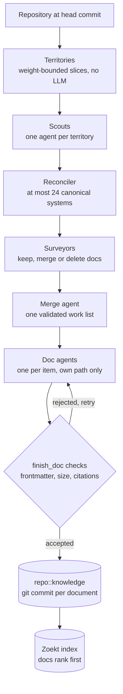

<p align="center">
  
</p>

<h1 align="center">Falkon</h1>

<p align="center"><strong>A self-hosted code search server for AI coding agents.</strong></p>

<p align="center">
  Index your Git repositories once. Any agent that speaks MCP can then search, read and cite your code.
</p>

<p align="center">
  <a href="LICENSE"></a>
  <a href="RELEASE_NOTES.md"></a>
  
  
  
</p>

---

Falkon is a service you run yourself. You give it a list of Git repositories. It indexes them and offers search, file reading, git history and symbol lookup as tools that an AI coding agent can call over [MCP](https://modelcontextprotocol.io), the Model Context Protocol that AI clients use to talk to external tools.

Falkon does not call a language model while it answers a tool request. Your agent's own model does the reasoning, and Falkon returns the source code the agent needs.

Every result states the repository, path, line range and commit it came from. If Falkon could not see part of a repository, the result says so. Without that note, an empty result would look the same as "no match".

For example, you ask your agent where API keys are validated. The agent calls `grep` to find candidate lines, then `read_file` to read one file. Each reply carries a repository, path and commit, so the agent can cite the exact lines it relied on.

## Contents

- [Why Falkon](#why-falkon)
- [Key terms](#key-terms)
- [What Falkon does](#what-falkon-does)
- [How it works](#how-it-works)
- [Evaluation](#evaluation)
- [Requirements](#requirements)
- [Quick start with Docker](#quick-start-with-docker)
- [Local development](#local-development)
- [Connecting an MCP client](#connecting-an-mcp-client)
- [Configuration](#configuration)
- [Query syntax](#query-syntax)
- [MCP tools](#mcp-tools)
- [Ask and the knowledge base](#ask-and-the-knowledge-base)
- [Security](#security)
- [Project layout](#project-layout)
- [Known limits](#known-limits)
- [Documentation](#documentation)
- [Contributing](#contributing)
- [License](#license)

## Why Falkon

Many tools that give an AI agent knowledge of a codebase use retrieval-augmented generation (RAG). A RAG system splits code into chunks, turns each chunk into a vector with an embedding model, stores the vectors, and returns the chunks closest to the question. Falkon does not work this way. It builds a text index of the code and gives the agent exact-search, file-read and git tools. The agent runs several queries, reads what they return and decides what to look at next.

The table lists what that choice means and how well each point is backed. "Measured" points link to the [Evaluation](#evaluation) section. "By design" points are properties of the architecture. Tests check them, but no accuracy evaluation measures them.

| Point | Basis |
| --- | --- |
| Falkon scored higher recall than the semantic stack it replaced (embeddings, reranker and vector database): +0.057 on dev and +0.094 on hidden questions. The gap is small next to run-to-run noise, so read it as "at least as good". | Measured, [result 1](#result-1-falkon-against-a-semantic-rag-stack) |
| No language model runs while Falkon serves a tool request. A variant that sent the agent through a model-driven research step first scored lower. | By design. The variant is measured in [result 2](#result-2-where-falkon-did-not-win) |
| Reindexing builds a Zoekt text index. No embedding model runs, so there are no vectors to rebuild when code changes. | By design |
| Every result names the commit it read and lists the parts of the repository Falkon could not see. | By design, pinned by `tests/contract` and `tests/golden` |
| The whole stack needed about 545 MB in the semantic-stack comparison and 665 MB at 0.1.0. The semantic stack's MCP server alone needed about 1.5 GB. | Measured, [result 2](#result-2-where-falkon-did-not-win) |

Falkon is a weaker fit when your questions contain no identifiers or phrases to search for. The evaluation covers cross-repository code questions only, so it says nothing about vague conceptual questions. See [what the evaluations do not show](#what-the-evaluations-do-not-show).

## Key terms

| Term | Meaning |
| --- | --- |
| Product | A named group of repositories that Falkon serves together. Each Product has its own MCP URL, and every question is about exactly one Product. |
| Zoekt | An open-source code search engine ([sourcegraph/zoekt](https://github.com/sourcegraph/zoekt)). Falkon uses it to index and search code. |
| Shard | One file of the Zoekt search index. |
| Git mirror | A full copy of a repository's history, stored on the Falkon server with no checked-out files. Falkon reads files and git history from it. |
| Index revision | The commit of a repository that the search index was built from. Every result names it. |
| Coverage gap | A part of a repository that Falkon could not see at that commit, for example a file that failed to parse. Results list gaps so that an empty answer is not read as "nothing there". |
| Knowledge base | Optional architecture documents that a language model writes about each repository. Falkon checks every citation in them against the code. |
| Ask | A chat in the web app that answers questions about one Product with the same tools an MCP client uses. |
## What Falkon does

- **Searches every repository in a Product at once.** Zoekt indexes each repository's default branch, plus any branches and tags you list. It answers literal and regular-expression queries.
- **Reads files at a fixed commit.** `read_file` and `list_tree` read from the git mirror at the index revision, so the content always matches the commit a result cites.
- **Shows history and changes.** `list_commits`, `list_branches` and `get_diff` read git history without a checkout.
- **Finds symbols.** `find_symbol_definitions` and `find_symbol_references` use universal-ctags, a tool that lists the definitions in source files. They answer where a name is defined or mentioned.
- **Groups repositories into Products.** The engine applies a Product's repository scope before any search runs.
- **Writes architecture notes.** An optional knowledge base produces citation-checked documents for each repository. Falkon accepts a document only when every citation resolves at the commit it describes.
- **Includes a web UI.** The Falkon UI sets up Products, shows index status, hosts an Ask chat and gives MCP clients a connect page.

## How it works

Falkon has four main parts. The engine API answers MCP calls and admin requests. A backend worker clones repositories and builds the index. Zoekt serves search. Postgres stores the registry of repositories, Products and chats. Redis holds the job queue.

### System components

The diagram shows every service in the Docker Compose stack and the outside systems it talks to. Select it to open the full-size image.

[](docs/diagrams/falkon-system-components.svg)

| Part | What it does |
| --- | --- |
| Engine API (NestJS), ports 3001 and 3002 | Serves MCP at `/mcp/<product>` on port 3001 and the admin API on port 3002. |
| Falkon UI (Next.js), port 3100 | Browser UI for Products, index status, connect snippets and settings. |
| Web app (Next.js), port 3000 | Search page, Ask chat and the older MCP route `/api/mcp`. |
| Backend worker | Fetches from code hosts, writes git mirrors, runs `zoekt-git-index` and runs knowledge base scans. |
| `zoekt-webserver`, port 6070 | Search server. It reads shards from the data volume and is reachable only inside the stack. |
| Postgres | Registry of repositories and Products, chat history and the knowledge base index. |
| Redis | BullMQ job queues. |
| `/data` volume | Git mirrors and Zoekt shards. |

The compose file publishes only the ports you need, and only on host loopback. Zoekt has no authentication, so compose never publishes its port.

### Search request path

A search goes through the engine API to Zoekt. A file read skips Zoekt and goes to the git mirror.

[](docs/diagrams/falkon-search-path.svg)

1. The MCP client calls `grep` on `/mcp/<product>`.
2. The engine parses the query into a tree called the query IR (intermediate representation). User text only goes into leaf nodes of that tree, so a query cannot add an `or` branch or widen the set of repositories.
3. The engine applies the Product's scope and asks Zoekt for one more match than it will return, so it can tell whether the result is complete.
4. Zoekt returns the matches and the index revision.
5. The engine replies with the hits, the revision and any coverage gaps.
6. For `read_file`, the engine reads the file at the index revision from the git mirror and returns the content with an evidence span (repository, path and line range).

### Repository sync and index lifecycle

Connection sync runs on the schedule in `settings`. A config change or an admin sync request also starts work. Each repository then moves through the states below.

[](docs/diagrams/falkon-repo-lifecycle.svg)

- **PENDING.** A connection found the repository and queued it.
- **SYNCING.** The `repo-index` job clones or fetches the repository and writes Zoekt shards.
- **INDEXED.** The new shards are swapped in and served. The repository returns to SYNCING when the reindex interval passes or a new commit appears.
- **FAILED.** The job ran out of attempts. A retry or resync moves the repository back to SYNCING.
- **Removed.** The repository was dropped from the config. Falkon deletes its shards and git mirror.

A failed repository keeps serving its last good index. The `repo-index` job retries twice with exponential backoff.

### Knowledge base pipeline

The knowledge base is optional. It needs the `LLM_*` environment variables. Without them Falkon skips scans and records nothing.



1. **Territories.** Falkon splits the repository into slices of bounded size. No model is involved.
2. **Scouts.** One agent reads each territory and reports what it finds.
3. **Reconciler.** One agent merges the reports into at most 24 canonical systems.
4. **Surveyors.** Agents decide whether each existing document should be kept, merged or deleted.
5. **Merge agent.** One agent combines the decisions into a single validated work list.
6. **Doc agents.** One agent per work item writes a document, and each agent can write only its own path.
7. **`finish_doc` checks.** Falkon checks the frontmatter, size and citations of each document. A rejected document goes back for a retry. An accepted document is committed to the `<repo>::knowledge` repository, one commit per document, and Zoekt indexes it with documents ranked first.

Each scan spends at most `tokenBudget` tokens (2,000,000 by default). Cache hits cost nothing. Agents read only the repository they document, unless `citeRepos` lists others.

Explorable HTML versions of the system, search and lifecycle diagrams, with dark and light themes, are in [`docs/diagrams/`](docs/diagrams/). Download a file and open it in a browser. GitHub does not render HTML files.

## Evaluation

Falkon's design choices came from measurements, and this section reports them, including the ones that did not favour Falkon. The full record for the RAG comparison is [ADR 0001, section 2.2](docs/adr/0001-falkon-architecture.md#22-evidence-cycles-17-and-18). The harness, datasets and scoring code are in [`tests/eval`](tests/eval).

### What was measured

- **Corpus.** The O3 Product, 42 OpenMRS repositories, each pinned to a commit. The harness refuses a checkout at any other commit.
- **Questions.** 40 cross-repository questions, 10 in each of four kinds. They ask which REST code uses a core service method, which patient chart code uses a frontend framework function, how a user action flows from the frontend to a database write, and where a frontend feature is documented and implemented. Twenty questions name a symbol in backticks. The other twenty (the traces and the documentation questions) describe behaviour in words.
- **Paired runs.** Each question is asked in two phrasings, one that names the module and one that does not. That gives 80 paired runs per arm, split into 48 dev and 32 hidden.
- **Gold answers.** 142 required source spans (file and line range) across the 40 questions. Most are Java (68) and TypeScript (64), plus 10 in Markdown.
- **Agent.** Claude Sonnet in the RAG comparison and Claude Haiku 5.5 in later runs, run through the Claude Code command line against the tools under test. Every arm uses the same prompt and harness.
- **Recall.** The share of required spans covered by a span the agent cites. A cited span covers a required span when the file matches, the lines overlap, and the cited span is at most three times the required width plus 20 lines.
- **Precision.** The share of cited spans that cover a required span or a span accepted as equivalent.
- **Statistics.** Differences are paired by question. Confidence intervals (95%) come from a bootstrap with 10,000 resamples and a fixed seed. An interval that includes zero means the difference cannot be told apart from noise.

### Result 1: Falkon against a semantic (RAG) stack

Same harness, prompt, agent (Claude Sonnet) and questions for every row. The Falkon row comes from cycle 18, and the semantic stack row from its cycle 15 runs. The semantic stack is Falkon's earlier design, which used embeddings, a cross-encoder reranker and a vector database. It is not an off-the-shelf RAG product.

| Arm | Dev recall | Hidden recall | Cost per run (dev) | Memory |
| --- | ---: | ---: | ---: | --- |
| Falkon | 0.967 | 0.948 | $0.042 | about 545 MB for the stack |
| Semantic stack | 0.910 | 0.854 | $0.043 | about 1.5 GB for its MCP server |

Falkon minus the semantic stack, with 95% confidence intervals:

- Recall on dev is +0.057 (0.016 to 0.113). On hidden it is +0.094 (0.015 to 0.173).
- Precision on dev is -0.064 (-0.132 to 0.007), so Falkon is not more precise.
- Cost differences straddle zero.
- The record's verdict is that the semantic stack added nothing measurable. Lexical access with an agent loop matched retrieval-augmented access on recall, with less memory and no embedding or reranker models.
- Single-run noise is about 0.1 at these sample sizes, so the recorded gaps are a lean toward Falkon and not a proof.

### Result 2: where Falkon did not win

- **A model-driven research step.** An arm that sent the agent through a `research_codebase` tool first scored lower than plain tools. On Sonnet dev, recall was 0.905 against 0.950, precision was 0.509 against 0.583, and cost per run was $0.053 against $0.042. On Sonnet hidden it was 0.943 against 0.926, which is within noise. On Haiku, recall over 80 runs was 0.823 against 0.907. These are point estimates. This is why Falkon keeps no model on the serving path.
- **A code graph.** Relate and trace tools (cycle 12) and an impact tool (cycle 13) showed no recall gain on single-repository questions. The +0.68 recall gain on cross-repository questions measured access to the other repositories, which Falkon already provides. The graph is not built in 0.1.0.
- **The impact recipe.** An opt-in recipe that guides the agent through definition, references and callers scored 0.955 against 0.780 for plain tools on 11 impact questions (+0.174, interval -0.046 to 0.409). Eleven questions are too few for a firm conclusion, so read it as a direction. It lowered precision by about 0.04 on the 80-question set.
- **Memory.** The whole stack used about 545 MB in the RAG comparison and 665 MB at the 0.1.0 release, which is above the 654 MB ceiling set in the project's regression gate. The release treats memory as information and does not enforce it.
- **Precision.** Falkon's precision is 0.58 on Sonnet dev and 0.41 on Haiku. Agents cite extra spans that do not match a required span, and on dev Falkon was less precise than the semantic stack (-0.064, interval crosses zero).

### What the evaluations do not show

- **One corpus.** Every question is about OpenMRS O3, mostly Java and TypeScript. Other languages, other repository shapes and single-repository question answering were not evaluated, apart from the graph tools in result 2.
- **One question family.** All 40 questions ask which code is affected, how a request flows or where a feature is documented. Half name a symbol. None is a vague conceptual question with no identifiers, which is where a semantic index is most likely to help.
- **Few independent samples.** The 80 runs per arm come from 40 questions asked twice, and each question ran once per arm. Intervals are about 0.05 to 0.09 wide on each side, and the earlier record puts single-run noise near 0.1.
- **One agent family.** Only Claude Sonnet and Haiku 5.5 were used.
- **One RAG implementation.** The RAG comparison uses Falkon's own earlier semantic stack, measured in earlier cycles on earlier code. No other RAG product was tested.
- **Ask answers.** The Ask chat was checked with a 15-question smoke test (all 10 code questions answered as grounded or partial, and one citation was dropped), not with a scored accuracy evaluation.
- **Latency.** Mean wall-clock time per question was 34 seconds on Haiku and about 21 seconds on Sonnet, with 14 and 5 agent turns. Falkon was not compared against others on latency.

### Reproducing the results

The harness and datasets are in the repository. The raw run files are not, so a rerun gives you new scores, not the recorded ones.

```bash
pnpm --filter @falkon/eval eval -- stack up                      # Falkon over the 42 checkouts (needs Docker and EVAL_O3_DIR)
pnpm --filter @falkon/eval eval -- pilot --model haiku           # 5 dev questions first
pnpm --filter @falkon/eval eval -- run --split dev --model haiku
pnpm --filter @falkon/eval eval -- run --split hidden --model haiku
pnpm --filter @falkon/eval eval -- report --model haiku          # per-split tables from stored runs, no spend
```

The runs call Claude, so they cost money. The Haiku gate at the 0.1.0 release cost $0.59, and `EVAL_SPEND_CAP` limits spend. The header of [`tests/eval/cli.ts`](tests/eval/cli.ts) lists every option and environment variable.

## Requirements

Docker is the supported way to run Falkon. The image builds Zoekt, the Node packages and the UI.

| Requirement | Version | Used for |
| --- | --- | --- |
| Docker Engine with Compose v2 | Current release | Running the stack with `docker compose` |
| Free memory | About 700 MB for the stack | Measured at about 665 MB for 0.1.0 |
| Git | Any recent release | Cloning and reading repositories (installed in the image) |

Local development needs these in addition:

| Requirement | Version | Notes |
| --- | --- | --- |
| Node.js | 24 | The image uses `node:24` |
| pnpm | 10.28.0 | Pinned by `packageManager` in `package.json` |
| PostgreSQL | 17 | Holds the registry and the knowledge base index |
| Redis | 7 | BullMQ job queues |
| Go | 1.26 | Only to build Zoekt from the commit in `ZOEKT_REF` (`docker/Dockerfile`) |
| `zoekt-webserver`, `zoekt-git-index` | Built from `ZOEKT_REF` | Search server and indexer, on `PATH` |
| universal-ctags | Any recent release | Symbol tools. Set `CTAGS_COMMAND` if the binary has another name |

## Quick start with Docker

1. Clone the repository and copy the example files.

   ```bash
   git clone https://github.com/0xaeres/falkon.git
   cd falkon
   cp .env.example .env
   cp config.example.json config.json
   ```

2. Put a code-host token in `.env`, for example `GITHUB_TOKEN=...`.

3. Edit `config.json` to list your repositories. A minimal file looks like this.

   ```jsonc
   {
     "connections": {
       "github": {
         "type": "github",
         "token": { "env": "GITHUB_TOKEN" },   // reads the token from .env
         "repos": ["octocat/Hello-World"]
       }
     },
     "contexts": {
       "octocat": { "include": ["github.com/octocat/*"], "description": "Octocat repos" }
     }
   }
   ```

   Each `contexts` entry becomes a Product, and its name becomes the Product slug. This file creates a Product called `octocat`, served at `http://127.0.0.1:3001/mcp/octocat`.

4. Start the stack.

   ```bash
   docker compose up --build
   ```

Then open:

| URL | What it is |
| --- | --- |
| http://localhost:3000 | Web app: search, repositories, Ask |
| http://127.0.0.1:3100 | Falkon UI: Products, status, connect page, settings |
| http://127.0.0.1:3001/mcp/`<product>` | MCP endpoint for one Product |
| http://127.0.0.1:3002 | Admin API. Needs the admin token |

Open the Falkon UI and wait for your repositories to reach `INDEXED`. Then [connect an MCP client](#connecting-an-mcp-client).

The first `api` start creates an admin token. Show it, or reset it, from the repository root:

```bash
scripts/admin-token.sh show
scripts/admin-token.sh reset
```

## Local development

```bash
pnpm install && pnpm db:generate && pnpm db:push
pnpm dev:backend                                          # terminal 1
zoekt-webserver -index ./data/index -rpc -listen :6070    # terminal 2
pnpm dev:web                                              # terminal 3
```

To run the Falkon UI and the NestJS engine API as well:

```bash
pnpm --filter @falkon/api start
ENGINE_URL=http://127.0.0.1:3002 pnpm --filter @falkon/ui dev --hostname 127.0.0.1 --port 4311
```

Set `DATABASE_URL`, `REDIS_URL`, `DATA_DIR` and `CONFIG_PATH` in `.env`. The file `.env.example` lists every variable.

## Connecting an MCP client

Falkon serves MCP over Streamable HTTP. Point the client at the Product path:

```json
{
  "mcpServers": {
    "falkon": {
      "type": "http",
      "url": "http://127.0.0.1:3001/mcp/<product>"
    }
  }
}
```

When `AUTH_MODE=apiKey`, add `"headers": { "Authorization": "Bearer <key>" }`. The UI's Connect page shows the exact snippet for each Product.

The web app also serves an MCP route at `/api/mcp` on port 3000. It covers every repository the web app can see. Prefer the Product path, because it scopes every call.

## Configuration

`config.json` describes what to index and how to serve it. It follows the JSON schema at `packages/shared/schemas/falkon/config.json`. Comments and trailing commas are allowed. Falkon rejects an unknown key and the error names it.

| Key | Purpose |
| --- | --- |
| `connections` | Code hosts to sync. Types are `github` (cloud or Enterprise) and `git` (an http(s) remote, or a `file://` glob of local repositories indexed in place) |
| `settings` | Index limits, reindex and resync intervals, concurrency and timeouts, and the pull request sync settings below |
| `contexts` | Products. Each name is a Product slug and an MCP path |
| `environmentOverrides` | Environment values resolved at load time |
| `models` | Language models for Ask, of type `openai-compatible`, `openai` or `anthropic` |
| `knowledgeBase` | Knowledge base switches, budget and repositories to document |

A token is either `{ "env": "NAME" }` or `{ "googleCloudSecret": "..." }`. To convert a file written for an older Falkon build, run `pnpm convert-config /absolute/path/old.json > new.json`.

### Pull request sync

A GitHub connection syncs pull requests only when it sets `"discussions": true` (outbound traffic with your token). `DISCUSSIONS_SNAPSHOT_DIR`, when set, wins and no live sync runs.

| Key | Default | Effect |
| --- | --- | --- |
| connection `discussions` | `false` | Syncs pull requests of the connection's indexed repositories. A fine-grained token needs Pull requests: Read, Issues: Read and Contents: Read |
| `settings.discussionSyncIntervalMs` | 900000 (15 minutes) | Gap between syncs of a repository. A tick every 30 seconds enqueues at most 20 due repositories, oldest first |
| `settings.discussionReconcileIntervalMs` | 604800000 (7 days) | Gap between full reconciles, which re-read every pull request updated in the last 30 days |
| `settings.discussionBackfillMonths` | 24 | How far back a repository's first sync reads |
| `DISCUSSION_SYNC_INTERVAL_MS` (web) | 900000 | Set it to the same value as `discussionSyncIntervalMs`: the history tools call a repository stale after twice this |

**Turn it on.** In the GitHub connection of `config.json` set `"discussions": true`. The connection's own token does the reading, so it needs these permissions:

- Fine-grained token: Pull requests: Read, Issues: Read (a pull request's conversation comments come from the issues API) and Contents: Read (cloning).
- Classic token: scope `repo` (private repositories) or `public_repo` (public only).

Every run of a repository starts by probing its pull requests and issue comments with one small read each. A refusal marks the repository `no-access`; the history tools then report a coverage gap that names the missing permissions, and other repositories keep syncing.

**Prove it with a real token.** The smoke script syncs two small public repositories (default `openmrs/openmrs-module-dataentrystatistics` and `openmrs/openmrs-contrib-keycloak-smart-auth`; pass `owner/name` arguments to change them) into a throwaway Postgres container named `falkon-eval-sync-pg`. It needs Docker, git and pnpm, and removes the container on exit. It reads the token from your shell's environment (or prompts for it when unset in a terminal) and never prints or stores it. It prints repositories synced, pull requests stored, commit links (rule and api), requests used and remaining budget, the permission probe result per repository, and `PASS` or `FAIL` with the first failing reason. It pulls `postgres:17-alpine` over the network and clones the repositories from github.com. Any token that can read public repositories works for the test (a fine-grained token limited to the owner's own repositories may not). A classic token with `repo` scope works but grants write access to all the owner's repositories, so create it only for the smoke test and delete it afterwards; a classic token with only `public_repo` is enough for public repositories. The smoke reads a 120-month window (printed as `backfill window: 120 months`; the product default stays 24), because the default repositories are old and 24 months would find almost nothing. Expected for the default repositories, as rough ranges from the recorded fixtures and not exact: about 7 pull requests stored in total, and at least some rule links and some api links (the api link comes from the rebase-merged pull request 2 of `openmrs-module-dataentrystatistics`). Type the token yourself, never paste it into a chat or an agent session:

```sh
read -rs GITHUB_TOKEN && export GITHUB_TOKEN
scripts/sync-smoke.sh
```

**Freshness.** With `MCP_HISTORY_TOOLS=on`, every history tool result lists, for each repository it read, `lastSyncedAt` and `stale`. `stale: true` (with a `reason`) means the last success is older than twice the sync interval, the last run failed, the sync is waiting for the rate limit, or the token cannot read the repository. The data is still served from what was stored; an agent should treat it as possibly behind GitHub and say so. The tools read only Postgres and never call GitHub.

**Limits.** Polling only: no webhooks, so a change shows after the next run (15 minutes by default). Pull requests only: issues are not synced. A first sync reads the last 24 months of pull requests; older history stays reachable through git. A pull request with more than 100 comments, reviews or files, or 30 review threads, is stored with those parts cut and flagged `truncated`. When the rate-limit budget falls below 10% the sync stops, saves its progress and resumes after GitHub's reset time.

### Environment variables

| Variable | Default | Effect |
| --- | --- | --- |
| `FALKON_API_KEY` | unset | Requires `Authorization: Bearer <key>` on `/api/*` in the web app |
| `AUTH_MODE` | `none` | `none` admits every caller to a Product. `apiKey` requires a key from `ACCESS_FILE` |
| `ACCESS_FILE` | unset | JSON file of per-key repository scopes. With `apiKey`, a missing or malformed file denies everyone |
| `ADMIN_TOKEN` | generated | Admin bearer, at least 32 characters. Otherwise stored in `${DATA_DIR}/secrets/admin.token` |
| `FALKON_SECRET_KEY` | generated | Base64 of 32 bytes. Encrypts stored code-host tokens |
| `LLM_BASE_URL`, `LLM_API_KEY`, `LLM_MODEL` | unset | OpenAI-compatible model for Ask and the knowledge base |
| `API_ALLOWED_HOSTS` | loopback | Extra host names the listeners answer, for example behind a proxy |

## Query syntax

Terms are literal substrings. The regex toggle in the UI switches them to RE2 regular expressions. Filters combine with search terms, for example `repo:payments lang:typescript "retry limit"`.

| Syntax | Meaning |
| --- | --- |
| `foo bar` | Both terms, in any order |
| `"exact phrase"` | Literal phrase |
| `a or b`, `( )`, `-(group)` | Boolean grouping and negation |
| `file:`, `f:` | Limit to file paths |
| `-file:x` | Exclude file paths |
| `repo:`, `r:` | Limit to repositories |
| `rev:` | Branch or tag. `rev:*` searches every indexed revision |
| `lang:` | Language |
| `sym:` | Symbol name |
| `content:`, `c:` | Match content only |
| `reposet:a,b` | Named repository set |
| `archived:yes\|no\|only`, `fork:yes\|no\|only`, `visibility:public\|private\|any` | Repository filters |
| `context:` | Not supported |

## MCP tools

MCP clients and the Ask chat share one tool registry, so they see the same names and schemas.

| Tool | Question it answers |
| --- | --- |
| `grep` | Where does this text or pattern appear? |
| `glob` | Which paths match this pattern? |
| `read_file` | What does this file say at this revision? |
| `list_tree` | What is in this directory? |
| `find_symbol_definitions` | Where is this symbol defined? |
| `find_symbol_references` | Where is this symbol mentioned? |
| `list_repos` | Which repositories does this Product contain? |
| `list_branches` | Which branches are indexed? |
| `list_commits` | What changed recently? |
| `get_diff` | What does this commit or range change? |
| `ask_codebase` | Answer a question with a configured model (only when a model is set) |
| `list_language_models` | Which models can Ask use? |

Version 0.1.0 has no code graph. Change and impact questions run through the symbol and reference tools, guided by an "impact and change" recipe.

## Ask and the knowledge base

**Ask** is a chat over one Product. It calls the same tools, then answers with `@file:{repo::path:a-b}` citations that link to the source. The answer reads evidence from files the tools opened, and Falkon drops any citation that does not match them.

**The knowledge base** writes architecture documents for each repository and commits them to a companion git repository named `<repo>::knowledge`. Zoekt indexes that repository like any other, so search and MCP tools find the documents without extra tools. A knowledge repository is visible exactly when its owner repository is.

Enable it with `knowledgeBase.enabled` (on by default) and set the `LLM_*` variables. Without a model, Falkon logs `knowledge base skipped: no model configured` once and records no scan.

## Security

- **Localhost by default.** The engine binds `127.0.0.1` unless you change `API_HOST` or `API_ADMIN_HOST`. With `AUTH_MODE=none`, any process that can reach the port can read every configured Product. Use `AUTH_MODE=apiKey` before you expose either listener.
- **Admin API.** Every request needs the admin bearer token. The token never appears in logs, responses or the query string.
- **Zoekt has no authentication.** Its port stays inside the compose network. Never publish it.
- **Stored tokens are encrypted.** Code-host tokens use AES-256-GCM in Postgres. If you lose the master key, stored tokens become unreadable and you must enter them again. Key rotation is not implemented.
- **Not in 0.1.0.** Users, organizations, SSO, permission syncing and per-user ownership of connections.

To report a vulnerability, do not open a public issue. See [CONTRIBUTING.md](CONTRIBUTING.md#reporting-security-issues).

## Project layout

| Package | Role |
| --- | --- |
| `packages/db` | Prisma schema for repositories, connections, Products, chats and knowledge scans |
| `packages/shared` | Config schema, query parser and IR, Zoekt gRPC client, git readers, access policy, tool registry and knowledge base pipeline |
| `packages/backend` | Connection sync, clone and fetch, `zoekt-git-index`, reindex and resync jobs, knowledge base scans |
| `packages/web` | Next.js web app with search, repositories, Ask and `/api/mcp` |
| `packages/api` | NestJS engine API with `/mcp/<product>` and the admin API |
| `packages/contracts` | Zod schemas shared by the API and the UI |
| `packages/ui` | Falkon UI (Next.js) |
| `docker/` | Image build, including Zoekt |
| `scripts/` | Admin token helper, config converter, smoke test |
| `tests/` | Contract, golden, eval and originality checks |

## Known limits

- The code graph (relate, trace and potential impact over compiler-resolved edges) and the deterministic overview map are not built.
- Two turns on the same Ask thread at once overwrite each other. The last write wins.
- Connectors cover GitHub and generic git only. GitLab, Gitea, Bitbucket and Azure DevOps are not implemented.
- Search contexts are not supported.
- Automated browser tests do not cover Mermaid rendering, streaming or the failed-first-send flow.

## Documentation

- [`CONTEXT.md`](CONTEXT.md) is the domain glossary (Product, index revision, evidence, coverage gap).
- [`docs/adr/0001-falkon-architecture.md`](docs/adr/0001-falkon-architecture.md) is the architecture decision record.
- [`RELEASE_NOTES.md`](RELEASE_NOTES.md) lists what 0.1.0 includes.
- [`docs/diagrams/`](docs/diagrams/) holds the explorable HTML versions of the diagrams.
- [`CONTRIBUTING.md`](CONTRIBUTING.md) explains how to build, test and send changes.

## Contributing

Bug reports, fixes and documentation are welcome. Read [CONTRIBUTING.md](CONTRIBUTING.md) before you open a pull request. It covers the checks a change must pass, the rules for the architecture record and the naming rules.

## License

Falkon is licensed under the [Apache License 2.0](LICENSE).

Falkon builds on [Zoekt](https://github.com/sourcegraph/zoekt), which is also Apache-2.0. The Docker image ships Zoekt's license text under `/usr/share/licenses/zoekt/`.
