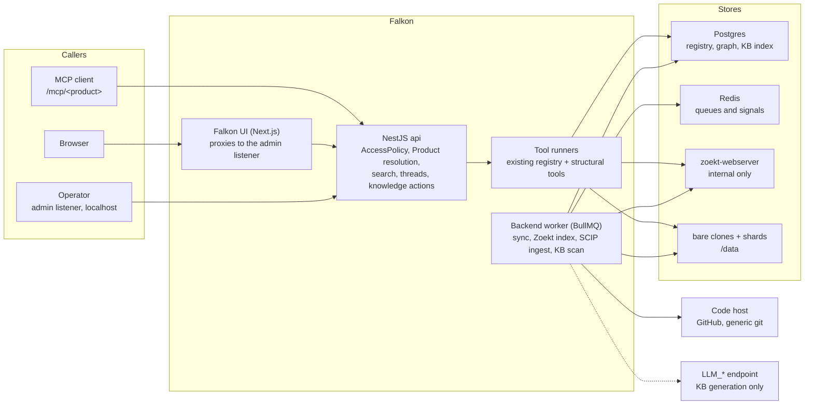
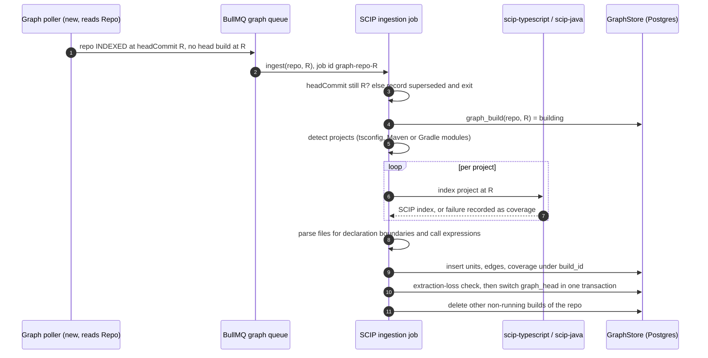

# ADR-0001: Falkon architecture

**Status:** Proposed
**Date:** 2026-10-18
**Scope:** This is Falkon's only architecture decision record. Change the architecture by amending this file in place; add no other ADR files. Terms in bold italics on first use are defined in [CONTEXT.md](../../CONTEXT.md).
**Sources:** Paths written as *earlier:* `path` are relative to the earlier design repository, which is a read-only donor until it is archived (D1). Its architecture record is the single file matching *earlier:* `docs/adr/0001-*-architecture.md`, cited below as *earlier ADR*. Decision tags D1 to D81 refer to the MVP delivery spec `.scratch/falkon-mvp/spec.md`; D82 onwards refer to the current delivery spec `.scratch/falkon-enterprise/spec.md`. Neither this record nor the spec takes precedence over the other: a conflict between them is raised to the human and resolved explicitly, then both are brought into line.

---

## Contents

1. [Summary](#1-summary)
2. [Context](#2-context)
3. [Architecture overview](#3-architecture-overview)
4. [Decisions](#4-decisions)
5. [Graph store schema](#5-graph-store-schema)
6. [SCIP ingestion and freshness](#6-scip-ingestion-and-freshness)
7. [Product isolation enforcement points](#7-product-isolation-enforcement-points)
8. [Failure handling](#8-failure-handling)
9. [Regression gate](#9-regression-gate)
10. [Non-goals](#10-non-goals)
11. [Risks and open questions](#11-risks-and-open-questions)
12. [Open decisions for the human](#12-open-decisions-for-the-human)
13. [Delivery plan](#13-delivery-plan)

---

## 1. Summary

Falkon is a self-hosted code context engine for any MCP client. It indexes a ***Product***'s repositories with Zoekt, keeps bare git clones fresh, and serves search, file reads, git history, and ***structural operations*** over MCP, with no model on the serving path (Ask is the open exception, [12](#12-open-decisions-for-the-human) item 1). Every result names its repository, path, and ***index revision***, and discloses its ***coverage gaps***.

The engine already does locate and read (Zoekt search, git readers, the eleven MCP tools, Ask, and the LLM-built ***knowledge base***). This record adds relate and trace, ***potential impact***, and a deterministic ***map***, and fixes the boundaries that keep the existing core safe while they are added.

| # | Capability | Question it answers | Status |
|---|---|---|---|
| 1 | Locate and read | Where is X, and what does it say? | Shipped: `grep`, `glob`, `read_file`, `list_tree`, `find_symbol_definitions`, `find_symbol_references`, `list_repos` |
| 2 | Relate and trace | What calls, uses, extends, or implements X; how does control reach B from A? | Deferred (D28). Served meanwhile by the ctags-backed tools and the impact-and-change recipe |
| 3 | Impact | What could a change to X affect? | MVP via the impact-and-change recipe over the shipped tools (D28); graph-based potential impact deferred |
| 4 | Overview | How does the Product fit together; where does a newcomer start? | Existing knowledge base documents; the deterministic map is deferred (D28) |
| 5 | Why and history | Why is it built this way; what changed and when? | Target (D82, 2026-10-22): git history first, then pull requests and issues, then tickets; measured on its own stratum first (Phase 0). Raw access exists today: `list_commits`, `list_branches`, `get_diff`. Pull requests are stored and linked to commits and tickets ([4.11](#411-provenance-store-and-pull-request-import-d106-d107-d110-to-d114), S48); their tools are S49 |
| 6 | Effort | How large is this change likely to be? | Later: needs history |

Each capability ships only after it beats the engine without it on its own question stratum (D8, [9](#9-regression-gate)).

| Decision | One line |
|---|---|
| [4.1](#41-stack-postgres-graph-behind-a-graphstore-port-d2) | Keep Postgres, Prisma, Redis, BullMQ, Zoekt; the graph lives in Postgres behind a `GraphStore` port. |
| [4.2](#42-serving-is-llm-free-the-knowledge-base-is-the-only-llm-feature-d3) | Serving is model-free; the knowledge base is the only LLM feature, on by default with auto-skip and a token cap. |
| [4.3](#43-mvp-capabilities-d4) | MVP is locate and read plus an impact-and-change recipe over the shipped tools; the graph, relate, trace, and map are deferred (D28); why, history, and effort are deferred. |
| [4.4](#44-delivery-shape-d5) | Self-hosted `docker compose`, GitHub and generic git only, no user model. |
| [4.5](#45-accesspolicy-port-and-product-in-path-scoping-d6) | `AccessPolicy` port with `none` as default and the API key adapter retained; Product in the MCP path; localhost bind and a separate admin listener. |
| [4.6](#46-nestjs-strangler-boundary-d7) | NestJS is a new boundary that delegates to the existing tool runners; sync and Zoekt stay untouched. |
| [4.7](#47-capabilities-earn-their-place-d8) | A capability ships only if it beats the engine without it. |
| [4.8](#48-originality-rewrite-and-rename-d9) | Rewrite inherited text originally and remove the predecessor's names; tool names and input schemas stay. |
| [4.9](#49-zoekt-upstream-probe-d10) | Probe upstream Zoekt before forking. |
| [4.10](#410-no-regression-d11) | A slice lands only when the four-check regression gate passes. |
| [4.11](#411-provenance-store-and-pull-request-import-d106-d107-d110-to-d114) | Pull requests in Postgres behind `ProvenanceStore`, loaded through `DiscussionSource`, commits linked and checked against the clone. |

---

## 2. Context

### 2.1 Problem

The earlier design built a semantic retrieval stack: declaration units, cAST search documents, embeddings, a cross-encoder reranker, a vector database, an ArcadeDB graph, and atomic Evidence Generations (*earlier ADR* sections 1, 4.3 to 4.11). It was measured against lexical access on the same questions and did not win (2.2). The question for Falkon is therefore which parts of that design add value on top of a lexical engine, and how to add them without risking the lexical engine that already matches the strongest baseline.

### 2.2 Evidence (cycles 17 and 18)

Both cycles ran the same harness, prompt, agent (Sonnet), and questions on the O3 Product (42 repositories), paired by question: dev 48, hidden 32. Recall is gold-citation recall; the rule is the cycle 17 rule (*earlier:* `.scratch/retrieval-eval/spec.md`, "Cycle 17 result" and "Cycle 18 result"; *earlier:* `.scratch/retrieval-eval/clone-migration-plan.md`, "Evidence").

| Arm | Dev recall | Hidden recall | Cost per run (dev) | Memory |
|---|---|---|---|---|
| This engine (cycle 18) | 0.967 | 0.948 | $0.042 | about 545 MB for the stack |
| The earlier design's semantic stack, slim arm (cycle 15 runs) | 0.910 | 0.854 | $0.043 | about 1.5 GB for its MCP server |
| The reference v6 release (cycle 17) | 0.973 | 0.923 | $0.039 | about 1 GB |

- This engine minus the semantic stack: dev recall +0.057 (95% CI 0.016 to 0.113), hidden +0.094 (CI 0.015 to 0.173); cost differences straddle zero; precision is lower on dev (-0.064, CI -0.132 to 0.007).
- Verdict on every split: the semantic stack is not differentiated. Lexical access with an agent loop equals retrieval-augmented access on recall at lower memory and no model spend.
- Single-run noise is about 0.1 at these sample sizes, so the gaps are a lean, not a proof (*earlier:* `.scratch/retrieval-eval/spec.md`, cycle 17 drift check).
- Map: cycle 17 compared the reference v6 release with a map against the earlier design's slim arm with a map, on dev only: recall -0.019 (CI -0.083 to 0.046), precision -0.100 (CI below zero). That compares two engines that both have a map; it does not isolate adding a map to lexical access, so the incremental benefit of a map remains unproven (*earlier:* `.scratch/retrieval-eval/spec.md`, "Cycle 17 result").
- Relate and trace (cycle 12) and impact (cycle 13) showed no recall gain on single-repository strata; the cross-repository stratum gained +0.68 recall on dev, but that measured access to the other repositories, which this engine now supplies (*earlier ADR* 4.10, "Baseline check").

Scope of this evidence (2026-10-22): every stratum above asked about source code. Whether dense retrieval helps over prose sources (pull request discussions, tickets, design documents) is unmeasured; it is decided on those sources' own strata (D84).

Consequences for this record: the lexical core is kept as is (D7, D11); embeddings, reranking, and the vector database are dropped (D2); the structural and map capabilities are built but must earn their place per stratum (D8).

### 2.3 The engine today

| Area | Where | What it does |
|---|---|---|
| Registry | [`packages/db/prisma/schema.prisma`](../../packages/db/prisma/schema.prisma) | `Connection`, `Repo` (with `headCommit`, status, knowledge base fields), `SearchContext`, `Chat`, `KnowledgeScan`, `KnowledgeDoc` |
| Sync | [`packages/backend/src/sync.ts`](../../packages/backend/src/sync.ts) | Mirrors config connections into rows, upserts repos per connection, removes orphans with their shards and knowledge base, resolves search contexts |
| Search | [`packages/shared/src/queryParser.ts`](../../packages/shared/src/queryParser.ts), [`ir.ts`](../../packages/shared/src/ir.ts), [`zoekt.ts`](../../packages/shared/src/zoekt.ts) | Query string to IR to Zoekt gRPC; user text only lands in IR leaves. The Falkon UI searches through `GET /ui/products/:slug/search` on the api admin listener, which calls `search` with the Product's repository filter |
| Tools | [`packages/shared/src/tools.ts`](../../packages/shared/src/tools.ts) | One registry of ten tools used by MCP and Ask; `list_language_models` and `ask_codebase` are added in [`packages/api/src/engine/mcp.ts`](../../packages/api/src/engine/mcp.ts) |
| Access | [`packages/shared/src/access.ts`](../../packages/shared/src/access.ts) | API keys resolve to a `Scope` (`allows`, `repoFilter`); no keys means open access |
| Knowledge base | [`packages/shared/src/kb/`](../../packages/shared/src/kb/), [`packages/backend/src/kb/`](../../packages/backend/src/kb/) | Multi-stage LLM pipeline, citation validation, a companion git repository per owner repo indexed by Zoekt; config `knowledgeBase.enabled` defaults to `true`. The Falkon UI requests scan, delete and re-include through `POST /ui/products/:slug/knowledge` on the api admin listener, which sets `kbRequest` and `kbRequestedAt` for the backend to act on |

---

## 3. Architecture overview

Ports and their adapters. Domain and use cases depend only on ports; a backend change is an adapter change.

| Port | MVP adapter | Used by |
|---|---|---|
| `AccessPolicy` | `none` (default), `apiKey` (wraps `authenticate` in `access.ts`) | NestJS boundary |
| `ProductRegistry` | Products from config, repos from the `Repo` table | NestJS boundary, map |
| `GraphStore` | Postgres tables of [5](#5-graph-store-schema) | Structural tools, map, SCIP ingestion |
| `StructuralIndexer` | `scip-typescript`, `scip-java` run as external processes | SCIP ingestion job |
| Search and git readers | Existing `zoekt.ts` and `git.ts` | Tool runners (unchanged) |
| LLM | Existing `kb/llm.ts`, OpenAI-compatible | Knowledge base scans only |
| `ProvenanceStore` | Postgres tables of [4.11](#411-provenance-store-and-pull-request-import-d106-d107-d110-to-d114) (raw SQL in `packages/shared/src/provenance.ts`); the graph database later (4.1 amendment) | Pull request import job, history tools |
| `DiscussionSource` | Recorded snapshot (`packages/backend/src/discussions.ts`); live GitHub next (D107) | Pull request import job |

---

## 4. Decisions

### 4.1 Stack: Postgres graph behind a `GraphStore` port (D2)

**Decision.** Keep Postgres, Prisma, Redis, BullMQ, and Zoekt. Adopt NestJS at the HTTP and MCP boundary only, Zod 4 at trust boundaries, ports and adapters, and SCIP indexers for TypeScript and Java. Drop Chroma, embeddings, the reranker, and MiniSearch. Declaration units, edges, and coverage live in Postgres behind a `GraphStore` port. Next.js remains as the UI only.

**Amendment (D85, D87, 2026-10-22; decided, not built).** Postgres holds every table added before SCIP ingestion exists, including provenance links behind a `ProvenanceStore` port. When SCIP ingestion is built, ArcadeDB (Apache 2.0) replaces Postgres as the `GraphStore` adapter and the provenance links move into it; the port, the build and head semantics of [5](#5-graph-store-schema), the coverage records and P7 carry over. Before any tool reads from ArcadeDB it must pass capacity on the O3 Product, restart, backup and restore. The registry stays in Postgres. Option A below is therefore the chosen graph store from that point; the text of this section describes the decision as first made.

**Why.** The evidence in [2.2](#22-evidence-cycles-17-and-18) removes the reason for the vector stack. Postgres already runs in the stack, holds the registry the graph must join against, and gives transactions for the per-revision head switch ([6](#6-scip-ingestion-and-freshness)) without a second store and its consistency problem. The structural operations are bounded traversals of a few hops ([4.3](#43-mvp-capabilities-d4)), which recursive CTEs over two indexed columns serve; the earlier design listed a relational database with recursive CTEs among its alternatives (*earlier ADR* 4.11). The port keeps a graph database possible if Postgres fails the size or latency probe ([11](#11-risks-and-open-questions)).

| Option | Extra process | Joins with registry | Traversal | Memory budget (+20% over 545 MB) |
|---|---|---|---|---|
| A. ArcadeDB as in *earlier ADR* 4.11 | Yes, a JVM | Across stores | Native graph queries | At risk |
| B. In-memory graph per Product loaded by the MCP server (*earlier ADR* 4.10, 2026-10-17 amendment) | No | In process | Fast | Grows with the Product; reload on every resync |
| **C. Postgres tables behind `GraphStore`** | **No** | **Same database** | **Recursive CTE, bounded hops** | **Requires measurement (S7)** |

### 4.2 MCP serving needs no model; knowledge base and UI Ask use server models (D3)

**Decision, amended 2026-10-19.** The MCP serving path needs no model. Knowledge base generation and the UI's server-LLM Ask use server models. Knowledge base generation is **on by default** and uses the operator's `LLM_*` environment. **As built (S11, 2026-10-21).** `knowledgeBase.enabled` defaults to `true`. Without a model (`LLM_BASE_URL`, `LLM_API_KEY`, `LLM_MODEL` not all set) nothing runs: no scan row is created, nothing throws, the backend logs `knowledge base skipped: no model configured` once per process, and a manual scan request stays pending until a model exists. Each scan is capped by `tokenBudget` (default 2,000,000). The first scan of a repo (`kbScannedCommit` null) logs `kb <repo> first scan estimate ~N tokens (cap M)` before its first model call; N is the blob bytes at head divided by 4, capped at M (an upper bound: it counts every file, lockfiles included). The state is surfaced as `knowledge` on the Product status (4.5).

**Why.** MCP clients bring their own model; a second model on the serving path adds cost and an error source the caller cannot see (*earlier ADR* 4.1). The knowledge base runs offline, its citations are checked against the scanned commit before a document is accepted (`finish_doc` in `kb/docTools.ts`), and it reaches agents through Zoekt as an ordinary repository, so it adds no serving dependency. Default-on with auto-skip gives the feature to operators who already set `LLM_*` without making a model a requirement.

| Option | Operator effort | Spend risk | Failure mode |
|---|---|---|---|
| A. Off by default (replaced) | Must discover and enable | None | Feature unused |
| **B. On by default, auto-skip without a model, default token cap** | **None** | **Bounded per scan, estimate logged first** | **Skipped with a log line and a `no-model` status** |
| C. Model on the serving path (answer synthesis) | Must configure | Per query | Hidden paraphrase errors |

The human resolved the Ask exception in [12, item 1](#12-open-decisions-for-the-human). The existing `ask_codebase` tool still requires a configured server model. S18 adds server instructions, an `ask_codebase` MCP prompt, and a `research_codebase` tool that return guidance for the client's own model. The prompt and research tool share a brief builder, intersect requested repositories with the caller's visible inventory, and report unavailable names without expanding the selection. Citation examples use the existing formatter in `ask/prompt.ts`.

### 4.3 MVP capabilities (D4)

**Amendment (D28, 2026-10-19).** The MVP does not build the graph. The `GraphStore`, SCIP ingestion, the relate, trace, and impact tools, and the deterministic map (spec slices S6 to S10) and knowledge base write-back (S12) are out of the MVP; sections [5](#5-graph-store-schema) and [6](#6-scip-ingestion-and-freshness) record the deferred design and are not built. Change and impact questions are served by the ctags-backed tools (`sym:` search, `find_symbol_definitions`, `find_symbol_references`, search and read across the Product) driven by an "impact and change" recipe in the `research_codebase` brief and in the UI Ask (spec S25). The graph returns only if testers show impact questions this loop misses and it then beats plain search under D8. The decision text below is the original D4 and applies only when the graph returns.

**Decision.** MVP is locate and read (existing tools); relate, trace, and potential impact over SCIP edges for TypeScript and Java; overview as a deterministic map plus the existing knowledge base documents. Deferred: why and history, effort, the semantic overlay (*earlier ADR* 4.8), and cross-repository HTTP links. Package-level cross-repository edges from SCIP are not deferred by D4; whether the graph slices include them is open decision 2 in [12](#12-open-decisions-for-the-human).

Structural operations, all bounded by hop count, result count, and a deadline, all scoped to one Product, all returning evidence spans and coverage gaps:

| Operation | Question |
|---|---|
| `callers(unit)` | Which units call this one? |
| `callees(unit)` | Which units does this one call? |
| `references(unit)` | Where is this unit mentioned (calls included)? |
| `implementations(unit)` | Which units extend or implement this type or method? |
| `trace(from, to)` | Is there a call path from one unit to another, and which? |
| `impact(unit)` | Which units could a change here affect, through calls, references, imports, and inheritance? |

Edge vocabulary and derivation follow *earlier ADR* 4.4: `CALLS` (an AST call expression whose callee span matches a resolved SCIP reference), `REFERENCES` (a resolved reference not in callee position), `IMPORTS`, `EXTENDS`, `IMPLEMENTS` (SCIP relationships plus references inside heritage clauses), `CONTAINS`. A reference with several in-corpus candidates yields one edge per candidate, flagged with the candidate count; a reference with no in-corpus target is recorded by category (`package`, `builtin`, `external`, outside the indexed corpus, unresolved).

**Why.** These are the questions lexical search answers worst by construction: `find_symbol_references` matches a word, not a resolved symbol, so it cannot tell a call from a mention or one overload from another. The earlier design hand-checked single-target `CALLS` and `REFERENCES` edges at 68 of 68 correct on both corpora (*earlier ADR* 4.4, 2026-10-15 amendment). Why, history, and effort need sources (pull requests, review history) the engine does not ingest yet.

### 4.4 Delivery shape (D5)

**Decision.** Self-hosted with `docker compose`. Connectors are GitHub and generic git only. No SSO, no user model.

**Why.** It is the shape the engine already has and the one the evaluation measured; every extra connector or identity system widens the regression surface before the new capabilities are proven.

### 4.5 `AccessPolicy` port and Product-in-path scoping (D6)

**Decision.**

- Falkon issues no access keys. Access control sits behind an `AccessPolicy` port. `auth.mode: none` is the default and admits every repository of the requested Product. `auth.mode: apiKey` keeps today's adapter (`authenticate`, `scopeFor`, `loadAccessKeys` in `access.ts`) with its tests green, so keys can return without new design.
- A Product is a named repository set in config. MCP is served at `/mcp/<product>`. The engine resolves the Product from the path and injects its repository filter server side; the caller cannot widen it. Under `apiKey`, the effective set is the Product's repositories intersected with the key's scope.
- The engine binds to `127.0.0.1` by default. Admin operations (knowledge base scan, delete, include; resync) run on a separate listener that binds to localhost only and is not routed under `/mcp`.
- The GitHub token and `LLM_*` stay as operator secrets.

**Why.** The deployment is single-operator and local (D5), so keys mostly add friction; binding to localhost provides the network boundary. Product scoping is still needed because it is the unit of a question (CONTEXT.md, Product) and because one install can serve several Products. Putting the Product in the path makes the scope visible in client config and logs and needs no credential. Keeping the `apiKey` adapter behind the port means removing keys is reversible. The earlier design resolved Products from a registry for any authenticated caller and failed closed on unknown Products (*earlier ADR* 5.1); that rule carries over.

**Consequence of `auth.mode: none`.** Localhost is the only protection. Any process on the host, including any local user, script, or browser page that can reach the port, reaches every configured Product without a credential; admin operations additionally need the admin token (see "Admin token" below). Exposing either listener beyond localhost, by changing the bind address, publishing the port, or putting a reverse proxy in front, exposes that unauthenticated access to everyone who can reach it. An operator who needs either must switch to `auth.mode: apiKey` first.

| Option | Credential handling | Scope visible to caller | Reversible |
|---|---|---|---|
| A. Per-key repository allowlists only (*earlier:* `.scratch/retrieval-eval/clone-migration-plan.md`, phase 1 item 1) | Keys to issue and rotate | No, implied by the key | Yes |
| B. Product as a request parameter | None | Yes | Yes, but every tool schema changes, which breaks the tool contract ([9](#9-regression-gate)) |
| **C. Product in the path, `AccessPolicy` port, `none` default, `apiKey` kept** | **None by default** | **Yes** | **Yes** |

**As built (S4, 2026-10-19).**

- **Policy.** The `AccessPolicy` port lives in `packages/shared/src/accessPolicy.ts` beside `access.ts`, whose exports are unchanged. The environment variable `AUTH_MODE` selects it until the Falkon config schema takes it over (S13): `none` (the default when unset) or `apiKey`; any other value stops the service at start. `none` gives every caller the principal `anonymous` and the Product's whole set. `apiKey` accepts only `Authorization: Bearer <key>` on `/mcp/<product>` (no other header, no cookie), checks it with `authenticate` and `loadAccessKeys` against `ACCESS_FILE` (re-read when the file changes), and fails closed: an unset, missing, unreadable, malformed or empty access file denies everyone. The effective set is the Product's repository names that the key allows, passed to `scopeFor` as explicit names; a name containing `*` is dropped so a stored name can never act as a prefix pattern. A key with `*` is still limited to the Product.
- **Request order on `/mcp/<product>`.** Product name syntax (`^[a-z0-9][a-z0-9-]{0,62}$`, else 404); authentication (401 with one body for a missing or a wrong key, and no Product lookup); Product lookup (404); effective set (under `apiKey` an empty intersection is the same 404 as an unknown Product, so the response is no oracle for Product existence); session binding. `GET` is 405; every other method or path is 404.
- **Listeners.** One process, two Nest applications. The product listener binds `API_HOST:API_PORT` (default `127.0.0.1:3001`) and serves only `POST`, `DELETE` and `GET` on `/mcp/:product`. The admin listener binds `API_ADMIN_HOST:API_ADMIN_PORT` (default `127.0.0.1:3002`) and serves only `GET|POST /products`, `GET|PUT|DELETE /products/:slug`, `POST|GET /connections`, `DELETE /connections/:id`, `PUT /connections/:id/token`, `GET /connections/:id/repositories` and the seven UI-shaped routes `GET|POST /ui/products`, `GET|PATCH /ui/products/:slug`, `GET /ui/products/:slug/status`, `GET /ui/products/:slug/events` (S74) and `POST /ui/products/:slug/sync` and the seven thread routes `GET|POST /ui/products/:slug/threads`, `GET|DELETE /ui/products/:slug/threads/:id`, `POST /ui/products/:slug/threads/:id/messages`, `GET /ui/products/:slug/threads/:id/stream` and `POST /ui/products/:slug/threads/:id/stop` (S71), `GET /ui/products/:slug/search` (S67) and `POST /ui/products/:slug/knowledge` (S68) (bodies strict JSON, 64 KiB; the `/products` registry routes keep their operator shape); a route-enumeration test fails on any other route. The admin listener is always on (D37; it was env-gated in D27, see "Admin token" below). Every request needs exactly one `Authorization: Bearer <admin token>` header (scheme matched case-sensitively), checked after the method and `Host` allowlist and before routing or any body read; the sha256 digests are compared with `timingSafeEqual`, and every failure is the same 401 on every path. The token is never logged, echoed or accepted from the query, body or cookies. The admin API is for operators on the host and for the UI container, which reaches it as `api` (listed in `API_ALLOWED_HOSTS`) with the same bearer. The product listener neither needs nor reads the token. Compose publishes both on host loopback only. Both answer only a `Host` on loopback (plus `API_ALLOWED_HOSTS`), so a web page that rebinds its DNS name to loopback cannot reach them.
- **UI Products and status (S20b).** `POST /ui/products` validates the selected repository ids against the connection's code-host listing, then in one transaction creates the `source=api` Product (`definition.include` = exact `Repo.name`s, `connectionId` = the `api` Connection), sets that connection's `config.repos` to the union of the exact `org/repo` names of every UI Product on it (editing one Product never drops a repo another uses) and sets `Connection.syncRequestedAt`; the backend claims the marker at once, on the api's `request` signal (below), with its 30-second tick as the fallback, and fetches into the existing clones (never a reclone). `GET /ui/products/:slug/status` is a pure function of the Product's `Repo` rows and its connection: `failed` when a repo is FAILED or the connection has a `syncError` (gaps name the repo only, never provider text); else `building` until a repo is INDEXED, `updating` while others are in flight, `partly-behind` when `pushedAt > lastIndexedAt`, `current` otherwise. The status also carries an additive optional `knowledge` object `{state, detail?}` (D43), derived by the api from the config's `knowledgeBase` (cached 30 s) and the model env: `off`, `no-model`, else over the Product's selected member repos `scanning` > `failed` > `budget-exhausted` > `pending` (an indexed repo whose head differs from `kbScannedCommit`) > `ready`; a failure detail is a fixed string, never the stored scan error. The generation id is `g-` plus six hex of the sha256 of the sorted `repoName@headCommit` of INDEXED repos. `POST /ui/products/:slug/sync` (`retry`) sets the connection marker and `Repo.indexRequestedAt` on the Product's FAILED repos.
- **Change and request signals (cycle 18, S72; D155, D156, D160).** The api and the backend worker tell each other of changes over two bare Redis pub/sub channels (`falkon:changed`, `falkon:request`; no payload) through `packages/shared/src/signals.ts` (`ioredis`, a dependency of `shared`, used by both the api and the backend). The request row (`Connection.syncRequestedAt`, `Repo.indexRequestedAt`, `Repo.kbRequest`) stays the durable record. After writing one, the api publishes `request`, and the worker runs its claims at once (one claim pass at a time: a signal during a pass schedules exactly one more pass, and the `updateMany` claims keep each request exactly-once); the claims also run at worker start and on every 30-second tick, so a request written while the worker or Redis was down is still taken. `changed` is published by the api after Product create, edit and delete, sync and knowledge requests, and thread create and delete, and by the worker when an index, connection sync, knowledge base or pull request job starts, finishes or fails and after it claims a request. Publishing is best effort and never throws into a caller; the api starts and serves with Redis down, and ioredis reconnects and resubscribes by itself. The time schedules (reindex, config resync, pull request sync, knowledge base refresh) stay on the 30-second timer (D157). The settings `resyncConnectionPollingIntervalMs` and `reindexRepoPollingIntervalMs` were read nowhere and are removed (D158); a config file still naming them loads and ignores them.
- **Product event stream (cycle 18, S74; D151 to D154, D160, D161).** The UI no longer polls. `GET /ui/products/:slug/events` on the admin listener is a server-sent event stream (`text/event-stream`, `no-store`; an unknown Product is the usual 404 JSON before any stream opens). On connect it sends the full `status` event and the full `threads` event (the shapes are `productEventSchemas` in `packages/contracts`, which the api parses before sending and the UI parses on receipt); afterwards it sends each again only when its JSON differs from what that stream last received. `ProductEvents` (`packages/api/src/events.ts`) keeps the open streams per Product and subscribes to the `changed` signal only while at least one stream is open. A signal recomputes the status (the same bounded read as `GET .../status`) and the thread list (capped) of each Product that has an open stream, nothing else: the first signal recomputes at once, further signals within 500 ms are answered by one recompute after the window, however many streams or signals there are. A deleted Product ends its streams; a failed recompute leaves them open for the next signal. Each stream gets an SSE comment line every 25 seconds so idle connections stay open, and a closed stream leaves the watcher set at once. Redis down only delays pushes: the state is still read and sent on every connect. The UI proxies the stream at `/api/products/:id/events` without the 15-second request timeout (the same pass-through as chat). The browser keeps one `EventSource` per Product page (`packages/ui/src/lib/use-product-events.ts`), which reconnects by itself, each connection starting with the full state; a reconnect the proxy refuses (the engine restarting) closes an `EventSource` for good, so that case is reopened with a 1, 2, 4, 8, 15, 30-second backoff, and a stream that never connected is not retried. The status and thread list stay in the SWR cache, read once on load and written by the stream (no `refreshInterval`). While the stream is down after having been open, the workspace shell shows one "Reconnecting" notice; once a status has loaded, a lost connection never replaces the status page or the chat page with an error.
- **Chat transport (S21).** The UI chats over the AI SDK UI message stream. `POST /ui/products/:slug/threads/:id/messages` takes `{ text, languageModel? }` only (strict: a `messages` key or any other key is 400), so the server is the only authority on history: it loads the stored `Chat` (`productId` must equal the path slug, else the same 404 as an unknown thread), appends the user message and stores it before the model runs (an explicitly stopped turn keeps the question), refuses with 409 until the Product's first Evidence Generation exists, and runs the existing Ask agent (`createMessageStream`) with `selectedRepos` and the `Scope` both set to the Product's repositories, so a tool cannot read outside it (P9). The `ai` SDK loads on the first message request (dynamic import), not at start. After the model stream ends and before `finish`, the adapter `buildEvidence` (`packages/api/src/engine/ask/evidence.ts`) turns the final text into two persisted part types, `data-evidence` (a window of 3 lines around each cited range, at most 60 lines, read with `gitRead.readFile` at the revision the tool recorded) and one `data-answer` (paragraphs with `[n]` markers and their citations, `kind`, reasons). A reference counts only if exactly one file the tools read matches its repository and path suffix, the repository is in scope, and the span lies inside the file; at most 12 evidence items per answer; references inside code fences stay literal; the Ask prompt and `@file` format are unchanged except for a Falkon-owned addendum in the per-chat prompt (`REPLY_PROMPT`) that tells the model to put the marker line `<!--reply-->` after `<!--answer-->` when a message is purely conversational (a greeting, thanks, "what can you do"). A second addendum, `DIAGRAM_PROMPT`, is added to the per-chat prompt of the UI chat only (the blocking Ask and MCP `ask_codebase` paths never get it, so they stay model-free of diagram work and keep the mermaid guidance): it asks the model, when a diagram helps, for a fenced block tagged `archify` holding archify JSON (types `architecture`, `workflow`, `sequence`, `dataflow`, `lifecycle`; lane/column grid; no invented facts; at most two per answer). In the same step as `buildEvidence`, `buildDiagrams` (`packages/api/src/engine/ask/diagram.ts`) renders each `archify` fence with the vendored archify renderers (`packages/shared/vendor/archify`, MIT, version pinned in its `VERSION`, notices kept beside it) in a short-lived node child process (15 s timeout, 32 KB source cap, no network: a node `brand` object that would make the renderer fetch a URL is refused before the render) and persists one `data-diagram` part `{ type, html, source }` per success (`diagramSchema` in `@falkon/contracts`; `Answer.diagrams` is optional; embedded fonts are stripped from the page). A block that is invalid, fails to render or is beyond the cap yields no part and the UI shows its source as a code block; a corrupt stored `data-diagram` part is dropped alone and does not turn the answer into an abstention. A rendered page is about 590 KB, so after each stored turn `pruneDiagrams` (`packages/api/src/diagramPrune.ts`) keeps `data-diagram` parts only on the Product's 5 most recently updated threads and strips them from older ones (looking at 20 older threads per run, leaving their `updatedAt` unchanged); the fence text stays, so an older answer shows its diagram source as code. The UI shows a finished fence whose source matches a `data-diagram` as a sandboxed `<iframe srcdoc>` (`sandbox="allow-scripts"`, never `allow-same-origin`, so the page has an opaque origin and cannot reach the app), with a toolbar for source, copy, download HTML and full screen; while streaming, and for `mermaid` fences, nothing changes. The answer `kind` is decided by evidence first: any evidence is `grounded` or `partial` whatever the marker says (so "hey, where is auth?" stays grounded); no evidence plus the marker and a non-empty text is `reply` (the text becomes citation-free paragraphs, `abstention` is null, and `suggestions` holds fixed generic questions; the UI shows it as prose with a "Try asking" list, not the abstain card); no evidence without the marker is `abstention` with the model text, as before, so a model that forgets the marker fails safe. There is no separate classifier. `GET /ui/products/:slug/threads/:id` maps the stored messages to `Answer`s with the pure `messagesToAnswers` of `@falkon/contracts` (a message with no `data-answer` part, or one that fails `answerSchema`, becomes a fixed abstention), and the UI seeds `useChat` with the inverse `answersToMessages`. Threads are `Chat` rows with `productId`; a thread the UI creates has `createdBy = "ui"` and is private. The thread list for a Product shows chats created by the UI or by an anonymous caller, or marked `PUBLIC`; get, delete and continue are guarded by `productId` only. `ask_codebase` on `/mcp/<product>` saves its chat as a Product thread (D139), so it appears in the list when the caller was anonymous. `DELETE /ui/products/:slug/threads/:id` removes a thread only while it has no answer (204; 409 once it has one), which the UI uses to drop the thread it created when the first message fails, so a failed first send leaves no empty thread in the list. Generation is decoupled from the request (S71, D144 to D148): the turn runs to its end in the `api` process whether or not the client stays, its stream is buffered in memory by `LiveAnswers` (`packages/api/src/liveAnswers.ts`, one entry per running thread, dropped when the turn ends, so a late reader gets 204 and reads the stored answer), and the model run is aborted only by `POST /ui/products/:slug/threads/:id/stop` (204, also when nothing runs; the question stays stored, the answer is not). `GET /ui/products/:slug/threads/:id/stream` replays the running turn from its first chunk and follows it to the end (204 when none runs; any number of readers, e.g. two tabs, may read the same turn); both routes 404 on another Product's thread. A message while a turn runs on the thread is 409 `ANSWER_RUNNING`. The buffer is in process memory, not Redis or a `Chat` column, because the turn runs in this same process and the buffer lives exactly as long as the turn can; revisit only if more than one `api` instance runs. The UI resumes with `useChat` `resume` on a thread page, and a chat watchdog (a stream error that is not an `ApiError` keeps the answer shown as working and resumes at once on `online`, else after 1, 2, 4, 8, 15, then every 30 seconds without limit; a 204 reloads the thread) replaces the earlier "The answer didn't arrive" failure for dropped connections. The earlier NDJSON route and `streamEventSchema` are gone.
- **Credential storage (D29).** A code-host token sent to `POST /connections` is checked with `GET /user`, then sealed with AES-256-GCM (random 96-bit nonce, additional authenticated data `id|host|keyId`) into a `Credential` row; `packages/shared/src/credentialStore.ts` is the only code that reads the ciphertext (`openCredential`, enforced by a grep test) and the only place the master key is resolved: `FALKON_SECRET_KEY` (base64, 32 bytes), else the file `FALKON_SECRET_KEY_FILE`, else a key generated into `${DATA_DIR}/secrets/master.key` (mode 600). No response, error or log line carries a token (canary test); connection ids are 128 random bits; an `api` connection's config holds `{ "stored": "<credentialId>" }`, a variant the config-file schema rejects, and the config mirror never writes or deletes `source=api` rows. **Not hardened, by decision (internal testing first):** no host allowlist or SSRF checks on the code-host URL, no key rotation or re-encryption, no outbound-call wrapper limiting verbs and paths, no UI passphrase, no per-user ownership of connections (every holder of the admin bearer sees every connection), and the generated key sits beside the data volume it protects. Revisit before exposing the UI beyond loopback.
- **Admin token (D37, as built in cycle 6).**
  - One token per install: generated once into `${DATA_DIR}/secrets/admin.token` (32 random bytes as hex, 64 characters, mode 600), written race-safely by the same `writeSecretOnce` as `master.key`. Env `ADMIN_TOKEN` (at least 32 characters) overrides the file; a shorter value stops the service.
  - The admin listener is always on. The api compares sha256 digests with `timingSafeEqual` and re-reads the file on every request (cached by mtime, inode and size), so a reset needs no restart.
  - Fails closed: a file shorter than 32 characters after trim makes startup refuse and every request 401. Recovery: the api cannot start, so delete the file on the data volume and restart; a new token is generated.
  - The UI server reads the same file read-only from the data volume (`ENGINE_ADMIN_TOKEN` overrides) and never sends it to the browser.
  - Show or reset only through `scripts/admin-token.sh show|reset`, which needs host or volume access; `reset` refuses while `ADMIN_TOKEN` is set in the api container. Nothing in the app can read or change the token.
- **Registry.** Products are `Product` rows in Postgres (`slug` unique and immutable, `source` `config` or `api`, `definition` in the shape of a config context, resolved `repoNames`). The backend sync imports config `contexts` as `source=config` rows in the same step as `SearchContext`, deletes config rows no longer in config, never writes an `api` row except to re-resolve its own definition, and skips with a log line a context whose name is not a valid slug or whose slug an `api` row holds (the `api` row wins). Writes are conditioned on `source`, so a concurrent admin create cannot become a config row. The admin API creates, replaces and deletes `api` rows only (config rows answer 409; slug and source cannot change), resolves membership at write time, and validates bodies with strict Zod objects (JSON only, 64 KiB). The product path reads the registry on every request with no cache, so a membership change applies to the next request.
- **Sessions (P11).** The Nest layer keeps its own map from MCP session id to the Product's row id, the principal and the sha256 fingerprint of the sorted effective set at creation. A request carrying a session id is checked against it before `mcp.ts` sees the request: an id it never bound, one bound to another Product or principal, or one whose fingerprint no longer matches (membership or key scope changed) is a 404 `Session not found.`, and starts no session. A fingerprint mismatch also closes the session in `mcp.ts`. Only a request without a session id reaches `mcp.ts` unbound; the id in its response is bound then. The map holds at most 1,000 sessions and closes the least recently used one past that.
- **Known gap.** A Product's scope keeps today's knowledge base rule: a knowledge repository is visible when its owner is. The citation rule of [7.1](#71-knowledge-base-isolation) (P6) is not built (cycle 7, D44): `citeRepos` defaults to none, so the default-on knowledge base cannot cross Products, and it stays a known gap until `citeRepos` is used.

### 4.6 NestJS strangler boundary (D7)

**Decision.** A NestJS application serves `/mcp/<product>` and the admin listener. It delegates to the existing tool runners (`createToolRunner` in `tools.ts`) with a `Scope` built from the Product and the access policy. New capabilities go in new packages and additive tools. The old Next.js routes stayed until the contract and golden tests passed against the Nest boundary; they are now removed (S70, D135 to D142): the web package is deleted, the engine core (tools, MCP server, Ask agent) lives in `packages/api/src/engine/`, and the Falkon UI is the only web surface. It reaches search, threads and knowledge base actions through Product-scoped routes on the admin listener, so every UI call is scoped by Product (D135, D138). The plain HTTP Ask and chat endpoints and `/api/mcp` are not ported (D136); Ask is the UI chat and `ask_codebase` on `/mcp/<product>`, which saves a Product thread and returns a link to it in the Falkon UI (D139). The sync path and the Zoekt path are not modified by any MVP slice.

**Why.** The core is protected by behavior, not by caution: contract tests are recorded first ([9](#9-regression-gate)), and the new boundary is the only new code on the request path. NestJS gives dependency injection, guards for the access policy, and module boundaries for ports (*earlier ADR* 4.12) without touching the code that runs searches.

| Option | Risk to core | Effort |
|---|---|---|
| A. Extend the Next.js routes in place | Every change touches the shipped request path | Low |
| B. Rewrite the engine on NestJS | High; the evaluated core is replaced | High |
| **C. Strangler: Nest in front, delegating to existing runners** | **Low; old routes stayed until parity was proven, then were removed** | **Medium** |

**Packages added by the UI import (D13).** `packages/contracts` (`@falkon/contracts`, Zod 4, TypeScript source like `@falkon/shared`) holds the request, response and chat-part schemas that the engine and the UI both import; it depends on nothing in the engine, so the product-slug rule is copied from `isProductSlug` and a test pins the two to the same accept and reject list. `packages/ui` (`@falkon/ui`, Next 16 with React 19.3, the only Next.js app since S70) is the Falkon UI, imported with its history. It serves on host loopback port 3100 (compose service `ui`, Next standalone output); its route handlers proxy to the engine when `ENGINE_URL` is set and otherwise serve the mock, except chat, which needs the engine (see 4.5, chat transport). The engine's behaviour is unchanged by the import.

### 4.7 Capabilities earn their place (D8)

**Decision.** Every new capability must beat the engine without it on its own question stratum before it is enabled by default. Rule: the lower 95% CI bound of the recall difference is at or above -0.05 and the upper CI bound of the cost difference is below 0, or the lower recall bound is above 0. A capability that fails stays behind a flag. The eval harness and datasets are ported to `tests/eval`.

**Why.** The earlier design built relate, impact, and the map before they were shown to help, and none showed a gain on top of lexical access ([2.2](#22-evidence-cycles-17-and-18)). The rule is the one the earlier evaluation pre-agreed (*earlier:* `.scratch/retrieval-eval/clone-migration-plan.md`, principle 3).

### 4.8 Originality rewrite and rename (D9)

**Decision.** The product is named Falkon everywhere. Remove the predecessor product's name from names, environment variables, the API key header, the vendor-prefixed API paths, and the config schema `$id`. The config has its own Falkon schema (`packages/shared/schemas/falkon/config.json`, own `$id`; it describes only `github` and `git` connections, `settings`, `contexts`, `environmentOverrides`, `models` and `knowledgeBase`; the loader ignores the `$schema` value and an unknown key is named in the error), and `scripts/convert-config.ts` converts an old file once (unsupported connection types and keys are dropped with a stderr warning, `$schema` is set, the output is idempotent); no compatibility mode and no aliases. Rewrite all verbatim inherited text (Ask prompts, tool descriptions, knowledge base prompts) originally. Tool names and input schemas stay. Rename the `@falkon/*` packages and database names last, mechanically.

**As built (cycle 9, S34).** `FALKON_API_KEY`, `FALKON_CHAT_MAX_STEP_COUNT` and `FALKON_CHAT_MODEL_TEMPERATURE` replace the product-prefixed variables, and the version variable is dropped (the MCP server reports `falkon-mcp-server` `0.1.0`). Only `Authorization: Bearer` carries a key; the old key header is not read. Old names have no effect. **Amended (S70, D136, D142).** `FALKON_API_KEY`, the `falkon_key` cookie and the web routes `/api/chat`, `/api/chats`, `/api/ask` and `/api/mcp` are gone with the web package; keys are checked only by `AUTH_MODE=apiKey` against `ACCESS_FILE` on `/mcp/<product>`. A leftover `FALKON_API_KEY` in an operator's environment is ignored.

**As built (cycle 9, S36).** The Ask prompts (static, per-chat, chat naming), the ten tool descriptions and their parameter text, the `list_language_models` and `ask_codebase` descriptions, and the knowledge base prompts and validator messages are Falkon's own wording; the answer tag, reply marker, `@file:{repo::path:a-b}` syntax, `finish_doc` contract, tool names and input schemas are unchanged, and a prompt test pins the tag, marker and syntax. `tests/originality` (`ORIGINALITY_REF_DIR=<dir> pnpm originality`) scans the shipped prompt, tool and config-schema text for a shared run of 8 or more words against a reference text set and exits 1 on any; the recipe for building that set is kept in `.scratch/falkon-mvp/originality.md`. The reply guard also requires that no tool ran in the turn (`agent.ts` passes the tool-call count to `evidence.ts`), so a search that found nothing followed by the reply marker abstains. The eval leak detector no longer flags reads of Claude Code's own tool-result spill files.

**Why.** Falkon is a product; inherited text carries another vendor's licence terms and name. Tool names and schemas are the contract MCP clients and the regression gate depend on, so they stay. The rewrite runs under the Ask-quality check ([9](#9-regression-gate), check 3) because prompt wording moves answer quality. Renaming packages last keeps every earlier diff small.

| Option | Licence and naming risk | Client breakage |
|---|---|---|
| A. Keep names and text, add a Falkon layer | Remains | None |
| B. Rename with compatibility aliases | Low, but old names stay reachable | None |
| **C. Clean rename, original text, converter script** | **None** | **Old config files need one conversion; tool contract unchanged** |

### 4.9 Zoekt upstream probe (D10)

**Decision.** Probe upstream Zoekt at a pinned commit without the tenant and repo id indexer flags. If the golden query set ([9](#9-regression-gate), check 2) returns identical results and resync shard replacement behaves, use upstream; otherwise fork under the owner's organisation. The Apache-2.0 attribution to the Zoekt lineage stays.

**Why.** Today `docker/Dockerfile` builds a vendor fork because upstream lacked those flags. Upstream removes a dependency on a vendor's fork; a fork under the owner's control is the fallback if shard naming or deletion depends on the flags.

### 4.10 No regression (D11)

**Decision.** A slice lands only if all four checks in [9](#9-regression-gate) pass. Anything the reference v6 release does that the checks do not cover is a named non-goal ([10](#10-non-goals)), never a silent gap.

### 4.11 Provenance store and pull request import (D106, D107, D110 to D114)

Decisions in force: D106, D107, D110 to D114 and, for the live sync, D115 to D127.

**Decision (S48, 2026-10-23).** Pull requests, their comments, reviews, review comments and changed files live in Postgres (`Discussion`, `DiscussionComment`, `DiscussionFile`), with `ProvenanceLink` rows and one `DiscussionSyncState` row per repository, all keyed by repository and deleted with it. Writers and readers go through the `ProvenanceStore` port; its Postgres adapter is the only one until the provenance links move to the graph database (4.1 amendment). Data enters through the `DiscussionSource` port: the recorded snapshot of S47 (`DISCUSSIONS_SNAPSHOT_DIR`, imported by the backend after each repository's index job) and, since cycle 15, the live GitHub adapter (`packages/backend/src/githubDiscussions.ts`), through the same mapper, linker and writer. When the snapshot directory is set it wins and no live sync runs. Issues reuse the tables through `kind` (D110); no issue is synced.

- **Import.** One transaction per pull request upserts it by (repository, number) and replaces its comments, files and outgoing links as a set, so an edited or deleted comment is replaced and re-import is idempotent. Only pull requests updated at or after the repository's cursor are read again. Text is stored without NUL characters and with lone surrogates replaced; bodies are cut at 64K characters on a code-point boundary, and every cut (by the source or on import) is named in `truncated`. An item the source cannot read (malformed JSON, an invalid date or number) is skipped and counted in `skippedCount`, and the cursor stays put until it reads cleanly; the rest of the repository still imports. Author logins are stored, never emails (D114); a failed run stores a fixed error string, never provider text.
- **Commit links, first match wins.** (1) a pull request's merge commit sha; (2) a subject ending `(#N)` (squash); (3) a `Merge pull request #N from` subject. Rules 2 and 3 only name pull requests the store holds. A link is verified when its commit is in the local clone and reachable from the indexed default-branch head (the commits `git log <head>` lists); an unverified link is stored and hidden unless asked for. Head-branch shas are never stored, so a force push cannot leave provenance behind. (4) The `commits/{sha}/pulls` fallback (D125), live source only: for default-branch commits newer than the backfill window that no rule linked, the sync asks GitHub which pull requests contain the commit, at most 50 commits per run, newest first, and links only pull requests the store holds (source `commit-pulls-api`, verified). Every answer is remembered in `CommitPullProbe`, "none" included, so a commit is asked once; a none-answer is permanent, even though GitHub may associate a pull request with a commit later. A 404 or 422 counts as none. An `api` link is dropped when a rule link later displaces it. A backlog of unlinked commits drains 50 per run, and the repository's `headCommit` stays null (so the next run recomputes) until it is drained.
- **Pull request text links.** Ticket keys from the title, body and head branch name, for the operator's project keys (`DISCUSSION_TICKET_KEYS`) and Jira browse links only (D112); `#N` and `owner/repo#N` in the body as references, the second named `<host>/<owner>/<repo>`.
- **Live adapter (S51 to S56, amended 2026-10-24).** Polling only: no webhooks. It is opt-in per GitHub connection with `"discussions": true` (D123) and runs only in the backend worker (D127); the history tool module and the api tools import no network client. Transport is Octokit already in the backend, on github.com or the connection's enterprise `url`; no new dependency. Discovery uses the REST issues listing (`state=all`, `sort=updated`, `direction=asc`, `since`), keeping items that carry `pull_request`, with keyset paging: each request starts at the last `updated_at` read, and within one full page that shares a single time it pages by page number. Detail comes from GraphQL in aliased batches of 10 pull requests with the snapshot fragment and page caps (S47), so both sources store the same shape. A pull request with more than 100 comments, reviews or files, or 30 review threads, is imported with the `truncated` flag and not paged; the eval snapshot fetcher drains up to 5 pages. Only `login` is requested for users (D121). The **cursor** is the newest REST `updated_at` processed per repository; a stored item's time is the earlier of its REST and GraphQL times, so an interrupted run resumes without skipping. A null GraphQL node (a deleted or transferred pull request) is skipped on every run and holds the cursor: it counts in `skippedCount`, and later runs read it again. The first sync reads pull requests updated in the last `settings.discussionBackfillMonths` (default 24, D117).
- **Permissions and `access` (D115).** The code probes on every run, through `covers()`, which departs from decision D115 ("before the first sync and when the token changes") and costs two reads per repository per run. The probe is one read of the repository's pull requests and one of its issue comments (the conversation comments of a pull request come from the issues API, hence Issues: Read). A 403 or 404 stores `access = no-access`, the history tools report `pull requests not readable for <repo>: the token needs Pull requests: Read and Issues: Read`, and other repositories keep syncing. A repository found unreadable is probed again at most once an hour.
- **Rate limit (D118).** Every REST header and GraphQL `rateLimit` is read. When less than 10% of the budget remains, the next request is not sent: the run saves its progress, stores `status = waiting` with `waitUntil` = GitHub's reset time (`lastSuccessAt` stays; `headCommit` is cleared when the run imported anything, so the commit links are recomputed), and requeues itself delayed to that time. Only an exhausted budget with a reset time yields and waits. A 403 with a `retry-after` header or a rate-limit message is never treated as a refusal: it fails the run with a fixed error. The tools keep serving stored data.
- **Scheduler (D116).** A tick every 30 seconds enqueues each indexed repository that has a connection with `discussions: true` and a token and whose last run is older than `settings.discussionSyncIntervalMs` (default 15 minutes), never-run first and then oldest run, at most 20 jobs per tick. A repository that is `waiting` before its `waitUntil`, or `running` for less than 2 hours (a crash leftover is older), is skipped. Once a week (`settings.discussionReconcileIntervalMs`, default 7 days) a run re-reads every pull request updated in the last 30 days regardless of the cursor (the run starts from the older of the cursor and now minus 30 days), to catch edits that did not move the updated time.
- **Freshness in results (D122).** With `MCP_HISTORY_TOOLS` on, each history tool result lists for every repository it touched `lastSyncedAt` and `stale`, with a `reason`. `stale` is true when the last success is older than twice the sync interval, the last run failed, the run is waiting for the rate limit, or access is `no-access`. It is read from the stored sync-state rows (one bounded read, only repositories of the effective set); no tool calls GitHub. With the flag off nothing changes. The api learns the interval from the environment variable `DISCUSSION_SYNC_INTERVAL_MS`, which the operator keeps equal to `settings.discussionSyncIntervalMs`; if they differ, staleness is judged against the wrong interval.
- **Errors (D126).** A sync stores fixed strings only (`import failed`, `sync failed`, `not covered`, `commit probe failed`); GitHub's words, error bodies and the token never reach a log or a row.
- **Verification.** The adapter is tested on raw responses recorded once from public repositories (S51) through a fake transport. The Postgres variants of the new SQL (sync-state columns, `CommitPullProbe`, `replaceCommitLinks`, freshness) were verified by reading and by fake-store contract tests only; they are not yet run against Postgres until a disposable database run (`PROVENANCE_TEST_DATABASE_URL`). The real-token proof is the operator script `scripts/sync-smoke.sh` (D120), which has not been run by an agent.
- **Reads** take the caller's effective set and are bounded: at most 500 comments, files or links per call (the tools must say when a cap was reached); search ANDs at most 8 words as literal case-insensitive substrings (plain `ILIKE`, no extension) over title, body, head branch and comments, at most 20 hits a page, under a 2 s statement timeout. They read only Postgres; the tools that use them may add the local clone, never the code host. Isolation is P12 ([7](#7-product-isolation-enforcement-points)).

**Why.** D106 keeps one store and its transactions; the port keeps the planned move to the graph database an adapter change. Checking every commit against the clone means a link never points at a commit the Product cannot read.

---

## 5. Graph store schema

Sketch, not a migration. Tables sit in the existing Postgres database next to `Repo`, owned by the `GraphStore` adapter, and are written only by the SCIP ingestion job. Line and column positions are 0-based, half-open, as SCIP reports them. Rows belong to a **build** (one ingestion attempt of one repository at one revision), not to a bare revision, so a rebuild of the serving revision never overwrites the rows readers are using.

### 5.1 Tables

**`graph_build`**: one row per ingestion attempt.

| Column | Type | Notes |
|---|---|---|
| `id` | bigint | PK, identity |
| `repo_id` | int | FK `Repo.id` `ON DELETE CASCADE` |
| `revision` | text | commit the build describes |
| `status` | enum | `building`, `complete`, `failed`, `superseded` |
| `indexers` | jsonb | indexer names and versions per project |
| `attempt` | smallint | BullMQ attempt number of the run that wrote this row |
| `unit_count`, `edge_count` | int | totals |
| `extraction_loss` | int | units of the previous complete build missing from files that still exist at `revision` (the guard in [8](#8-failure-handling)) |
| `error` | text | |
| `started_at`, `finished_at` | timestamptz | |

Constraints and indexes: `graph_build_one_running` unique (`repo_id`) where `status = 'building'` (at most one build per repository runs); `graph_build_repo_rev_idx` (`repo_id`, `revision`, `status`).

**`graph_head`**: the build each repository serves. Queries read the graph only through this table.

| Column | Type | Notes |
|---|---|---|
| `repo_id` | int | PK; FK `Repo.id` `ON DELETE CASCADE` |
| `build_id` | bigint | FK `graph_build.id` `ON DELETE NO ACTION`: a serving build cannot be deleted on its own; deleting the repository removes the head and its builds in one statement |
| `switched_at` | timestamptz | |

**`graph_unit`**: declaration units.

| Column | Type | Notes |
|---|---|---|
| `build_id` | bigint | FK `graph_build.id` `ON DELETE CASCADE` |
| `id` | bigint | identity; PK (`build_id`, `id`) |
| `unit_key` | text | logical key: SCIP symbol for named declarations; `path`, enclosing symbol, kind, ordinal otherwise (*earlier ADR* 4.3) |
| `symbol` | text | SCIP symbol, nullable |
| `name` | text | display name for lookup |
| `kind` | text | `function`, `method`, `class`, `interface`, `type`, `variable`, `module` |
| `path` | text | |
| `start_line`, `start_col`, `end_line`, `end_col` | int | evidence span |

Constraints and indexes: `graph_unit_key_uq` unique (`build_id`, `unit_key`); `graph_unit_symbol_idx` (`symbol`, `build_id`); `graph_unit_name_idx` (`build_id`, `name`); `graph_unit_path_idx` (`build_id`, `path`, `start_line`).

**`graph_edge`**: resolved relationships and unresolved targets.

| Column | Type | Notes |
|---|---|---|
| `build_id` | bigint | FK `graph_build.id` `ON DELETE CASCADE` |
| `id` | bigint | identity; PK (`build_id`, `id`) |
| `kind` | enum | `CALLS`, `REFERENCES`, `IMPORTS`, `EXTENDS`, `IMPLEMENTS`, `CONTAINS` |
| `from_unit` | bigint | the enclosing unit of the occurrence; FK (`build_id`, `from_unit`) to `graph_unit` (`build_id`, `id`) `ON DELETE CASCADE` |
| `to_unit` | bigint | nullable; FK (`build_id`, `to_unit`) to `graph_unit` (`build_id`, `id`) `ON DELETE CASCADE`, so both endpoints lie in the same build by construction; null when the target is not in this repository |
| `to_symbol` | text | SCIP symbol of the target, always set |
| `target_category` | enum | null when resolved in this repository; else `package`, `builtin`, `external`, `outside`, `unresolved` |
| `targets` | smallint | candidate count; 1 for an unambiguous edge |
| `path`, `start_line`, `start_col`, `end_line`, `end_col` | text, int | occurrence span: the edge's evidence |

Indexes: `graph_edge_to_idx` (`build_id`, `to_unit`, `kind`); `graph_edge_from_idx` (`build_id`, `from_unit`, `kind`); `graph_edge_ext_idx` (`to_symbol`, `kind`) where `to_unit is null`, which serves cross-repository resolution if open decision 2 adopts it.

**`graph_coverage`**: what the indexers could not see.

| Column | Type | Notes |
|---|---|---|
| `build_id` | bigint | FK `graph_build.id` `ON DELETE CASCADE` |
| `id` | bigint | identity; PK (`build_id`, `id`) |
| `project` | text | `tsconfig` or build module root; null for repository-wide gaps |
| `path` | text | nullable; set for file-level gaps |
| `kind` | enum | `project-failed`, `build-prep-failed`, `parse-failed`, `language-unsupported`, `unresolved-references`, `ambiguous-references` |
| `count` | int | occurrences behind a counted gap |
| `detail` | text | |

Indexes: `graph_coverage_build_idx` (`build_id`, `kind`); `graph_coverage_path_idx` (`build_id`, `path`).

Cascade summary: deleting a `Repo` row deletes its `graph_head` and `graph_build` rows, and each build's units, edges, and coverage follow by cascade. Deleting a non-serving build deletes its rows. Deleting a serving build alone fails.

### 5.2 Per-revision replace, deduplication, and retry

- **Scheduling (additive, D7).** A new poller in the backend worker, modelled on the knowledge base scheduler in [`packages/backend/src/index.ts`](../../packages/backend/src/index.ts) (which enqueues `kb-<repoId>-<headCommit>` jobs for `INDEXED` repositories), reads `Repo` rows with `status = INDEXED` and a `headCommit`, and enqueues a job on a new graph queue with job id `graph-<repoId>-<headCommit>`. It only reads what sync already writes; sync and Zoekt indexing are not changed.
- **Same-revision deduplication.** The poller enqueues nothing when the repository's head build already has `revision = headCommit` and the same indexer versions, or when a build is `building`. The BullMQ job id deduplicates repeated polls of an unchanged `headCommit`, so scheduled re-indexing that succeeds again at the same HEAD causes no graph work.
- **Coalescing.** At job start, if the repository's `headCommit` is no longer R, the job records a `superseded` build and exits; the poller has already enqueued the newer revision.
- **Write and switch.** A build inserts its units, edges, and coverage under its own `build_id`, then one short transaction sets `status = complete` and points `graph_head` at it. A failed or superseded build never becomes the head, so a reader never sees partial rows.
- **Retry.** A failing job retries under BullMQ's `attempts` with backoff; each attempt is a new `graph_build` row, and the failed attempt's rows are deleted. After the last attempt the revision is not retried until `headCommit` changes or an operator requests a rebuild on the admin listener. A rebuild of the serving revision (for example after an indexer upgrade) is an ordinary new build that switches the head when complete.
- **Cleanup.** After a switch, builds of the repository other than the head and any running build are deleted.

### 5.3 Reader consistency

Each structural operation runs inside one read-only `REPEATABLE READ` transaction: head resolution, unit lookup, traversal, and coverage reads all see one database snapshot. Postgres keeps rows deleted by a later cleanup visible to an open snapshot, so a concurrent head switch or cleanup cannot remove rows mid-operation, and an operation never mixes builds. `statement_timeout` bounds how long a snapshot is held.

### 5.4 Fit with the structural operations

Every structural operation resolves its starting unit through `graph_unit` (by `symbol`, `name`, or `path` and line, within the head builds of the effective repository set) and then reads `graph_edge` by one of its two endpoint indexes. Each relationship returned carries the edge's occurrence span as evidence.

| Operation | Edge kinds | Direction and index | Shape |
|---|---|---|---|
| `callers` | `CALLS` | `to_unit = X`, `graph_edge_to_idx` | One hop, page by result count |
| `callees` | `CALLS` | `from_unit = X`, `graph_edge_from_idx` | One hop |
| `references` | `REFERENCES`, `CALLS`, `IMPORTS` | `to_unit = X`, `graph_edge_to_idx` | One hop |
| `implementations` | `EXTENDS`, `IMPLEMENTS` | `to_unit = X`, `graph_edge_to_idx`, repeated for transitive subtypes | Bounded recursive CTE |
| `trace(A, B)` | `CALLS` | forward from A by `graph_edge_from_idx`, stop at B | Bounded recursive CTE with a visited path to cut cycles |
| `impact` | `CALLS`, `REFERENCES`, `IMPORTS`, `EXTENDS`, `IMPLEMENTS` | reverse from X by `graph_edge_to_idx`; a method also climbs to the interface or superclass methods it implements, so calls through those count | Bounded recursive CTE |

Flagged edges (`targets` above 1) are returned as "one of n" and capped; edges with null `to_unit` are not traversed within a repository.

**Coverage disclosure per operation.** A result, including an empty one, carries every gap that could hide part of its answer, not only gaps on the paths it touched:

- Reverse operations (`callers`, `references`, `implementations`, `impact`) can miss sources anywhere in scope, so they report, for every repository in the effective set: `project-failed`, `build-prep-failed`, and `language-unsupported` records, file-level gap counts, a missing graph, and `graph-behind`.
- Forward operations (`callees`, `trace`) report the gaps of the projects and files their units lie in, plus the counts of unresolved and ambiguous targets they met.

The tables, indexes, and coverage records cover all six operations; no operation needs a column or index the sketch lacks.

---

## 6. SCIP ingestion and freshness

Rules:

1. **Trigger.** The poller of [5.2](#52-per-revision-replace-deduplication-and-retry) starts a build once the existing indexing step has recorded revision R as `headCommit`; the job reads the bare clone at R. It never blocks or delays Zoekt indexing (D7).
2. **Atomic replace.** All units, edges, and coverage of one repository at R become visible together, by the head switch.
3. **Read the last complete revision.** Queries read `graph_head` inside one snapshot ([5.3](#53-reader-consistency)). While a build runs, the previous complete build serves.
4. **Coalescing and deduplication.** As in [5.2](#52-per-revision-replace-deduplication-and-retry).
5. **Disclosure.** Every structural result states the graph's index revision per repository. When the head build's revision differs from the repository's `headCommit`, the result carries a `graph-behind` coverage gap naming both revisions. Per-project and per-file failures are coverage, not build failures.
6. **Full re-index per revision.** SCIP indexers are not incremental; each build re-indexes every project in the repository. Per-project reuse keyed by inputs (*earlier ADR* 4.4, "Incremental re-indexing") is deferred until build times are measured.
7. **Languages.** TypeScript and JavaScript through `scip-typescript`; Java through `scip-java`. Other languages produce a `language-unsupported` coverage record, so lexical tools remain the answer for them.

---

## 7. Product isolation enforcement points

A Product path must not read, search, list, or diff outside its repository set. Each point below applies the Product's effective repository set and fails closed; tests prove each one (spec S4).

| # | Point | Where | Rule | Status (S4) |
|---|---|---|---|---|
| P1 | Product resolution | NestJS boundary | Unknown Product returns not-found with no data; there is no fallback to all repositories. | Tested: `packages/api/src/app.test.ts` (unknown, malformed and lookalike names; no lookup before the syntax check) |
| P2 | Access policy | `AccessPolicy` adapter | `none`: the Product's set. `apiKey`: the Product's set intersected with the key's scope. The caller may narrow, never widen. | Tested: `packages/shared/src/accessPolicy.test.ts`, `app.test.ts` (apiKey order, 401 and 404 bodies) |
| P3 | Tool layer | `repoOrThrow` and `scope.allows` in `tools.ts` | Every repo-named argument is checked before any read; an out-of-set repo returns the same error as a missing one. `list_repos` filters by scope. | Tested through the Nest listener: `packages/api/src/isolation.test.ts` |
| P4 | Zoekt query | `searchIR` call in `tools.ts`, `search` in `packages/api/src/search.ts` | The repo filter is AND-ed into the query IR server side, and hits are post-filtered by `scope.allows`. User text cannot widen it (IR leaves only). | Tested at the tool level (query IR and post-filter, against a Zoekt fake that returns out-of-set hits): `isolation.test.ts`. The UI search route filters by the Product's repositories and post-filters hits (S67, D135; test with two Products) |
| P5 | Git readers | `read_file`, `list_tree`, `list_commits`, `list_branches`, `get_diff` through `git.ts` | Run only on a repo returned by P3; refs and paths stay validated against traversal and option injection. | Tested: `isolation.test.ts` (the core checks still apply on the Product path) |
| P6 | Knowledge base | KB scan (`citeRepos`) and `scopeFor` in `access.ts` | Rule in [7.1](#71-knowledge-base-isolation). | Deferred (D44); Product scopes keep the owner rule (known gap; safe while `citeRepos` is none) |
| P7 | Graph queries | `GraphStore` adapter | Head builds of the effective set only, at every hop of a recursive CTE, not only at the start; coverage scoped to the same set. | Out of scope: no graph yet (S6 to S9) |
| P8 | Map | Map tool | Built only from the effective set's registry rows, trees, and graph rows. | Out of scope: no map yet |
| P9 | Ask | `ask_codebase` and the UI thread routes | Selected repositories are intersected with the effective set before the agent loop runs. | Tested: `ask_codebase` receives the session scope (`isolation.test.ts`); the UI chat route sets `selectedRepos` and the `Scope` to the Product's repositories, a scripted model that asks a tool to read another Product's repository gets the missing-repository error and none of its content, and a thread of one Product is 404 under another on GET and on POST messages (`packages/api/src/threads.test.ts`). The plain HTTP chat routes no longer exist (S70), so every chat path is on the Product path |
| P10 | Admin operations | Admin listener | Scan, delete, include, rebuild, and resync are not reachable on the Product listener. | Tested over real sockets: `app.test.ts`, `admin.test.ts` (neither listener serves the other's routes); `adminAuth.test.ts` (admin always on, bearer required, generated token file, fail closed on a short file); KB scan and resync are not moved yet and have no token |
| P11 | MCP sessions and continuation state | Session store in the NestJS boundary (today `sessions` in [`packages/api/src/engine/mcp.ts`](../../packages/api/src/engine/mcp.ts), keyed by principal only) | A session and any continuation state are bound to the `productId` and a fingerprint of the effective scope at creation. A request that presents the session under another Product path, or with a different effective scope, is rejected, and starts no new session in its place. Under `none` every caller shares one principal, so the principal alone cannot serve as the binding. | Tested: `app.test.ts` (binding, replay, fingerprint, cap), `isolation.test.ts` (real MCP handlers, two Products at once) |
| P12 | Discussions and provenance links | `ProvenanceStore` adapter (`packages/shared/src/provenance.ts`) | Rows are keyed by repository, so a discussion is visible exactly when its repository is. Every read takes the effective set and filters by repository in SQL; a repository outside it reads like a missing one; a link whose other end is a repository outside it is dropped; a repository in it that was never imported is a coverage gap (`pull requests not ingested for <repo>`, or `pull requests not readable for <repo>` when the token was refused), never an empty result. | Tested: `packages/shared/src/provenance.test.ts` (in-memory store) and `packages/api/src/provenanceIsolation.test.ts` (Postgres, when `PROVENANCE_TEST_DATABASE_URL` names a disposable database), the same cases from `provenance.contract.ts` |

### 7.1 Knowledge base isolation

**Problem.** Today a knowledge repository is visible exactly when its owner is (`scopeFor`), while a scan may read and cite any repository that the global `citeRepos` setting admits (`packages/backend/src/kb/scan.ts`). A document can therefore quote a repository that some reader of the owner may not see. Two Products sharing a repository make this concrete: the shared repository's documents could cite a repository that only one of them contains.

**Decision.** One knowledge base per repository, constrained at both ends:

1. **Generation.** A scan of repository X may read and cite only repositories that belong to every Product containing X. `citeRepos` is restricted to that intersection; the default stays owner-only.
2. **Visibility.** A knowledge repository is visible to a reader only when its owner and every repository its documents cite (the union of `KnowledgeDoc.citations`) are in the reader's effective set. The check is made per repository, so it covers every tool, including `list_tree`, `read_file`, and git history.

Under `none`, rule 1 guarantees rule 2 for every Product reader. Rule 2 is the backstop for `apiKey` scopes, and for Product membership that changed after a scan: documents citing a repository that left the intersection stay hidden until a rescan regenerates them.

**Why this option.**

| Option | LLM spend | Leak surface | Cost |
|---|---|---|---|
| A. Generate and store a knowledge base per Product | Multiplied by the number of Products sharing a repository | None | Several knowledge repositories per owner, new naming, and several Zoekt indexes of near-identical text |
| B. One knowledge base, filter individual documents by their citations at read time | Once | The knowledge repository's git history (`list_commits`, `get_diff`) still shows filtered documents | Per-file filtering on every hit and read |
| **C. One knowledge base, citations limited to the Product intersection, repository-level visibility check** | **Once** | **None** | **Documents about a shared repository cannot cite repositories outside the intersection. A narrow key loses the whole knowledge base of that repository. Each visibility check reads the cite set (cached per knowledge repository). A membership change can hide a knowledge base until the next scan.** |

---

## 8. Failure handling

| Failure | Behaviour |
|---|---|
| Unknown Product, malformed path | Not found; no data. |
| SCIP indexer fails for one project | Build continues; `project-failed` coverage, reported as in [5.4](#54-fit-with-the-structural-operations). |
| File fails to parse | `parse-failed` coverage for that path. |
| Extraction loss: units of the previous complete build missing from files that still exist at the new revision exceed 10% of the previous build's units | Build marked `failed`; previous head keeps serving; results carry `graph-behind`. Units of deleted or renamed files do not count, so intentional deletion never trips the guard. An operator can accept the build through a rebuild on the admin listener. |
| Build fails for another reason | Retried as in [5.2](#52-per-revision-replace-deduplication-and-retry); previous head keeps serving; results carry `graph-behind`. |
| Pull requests never imported for a repository | History reads return a coverage gap naming it, not an empty result (P12). |
| Token cannot read a repository's pull requests (`no-access`) | The repository's sync stops at the probe; history reads return the coverage gap `pull requests not readable for <repo>` naming the missing permissions, and freshness shows `stale`. Other repositories keep syncing. |
| GitHub rate limit nearly spent (under 10% left) | The run saves its progress, records `waiting` with the reset time and resumes then; tools keep serving stored data with `stale` freshness. |
| No graph yet for a repository | Structural tools return no relationships and a coverage gap saying the repository has no graph. |
| Traversal hits its hop, count, or deadline limit | Partial result with the limit named; never silently truncated. |
| Postgres unavailable | Product resolution reads the `Repo` registry, so every request fails closed at P1. Beneath that, every tool that resolves a repository goes through Prisma (`getRepo` and `listRepos` in [`packages/api/src/engine/tools.ts`](../../packages/api/src/engine/tools.ts)), so these fail too: `read_file`, `list_tree`, `list_commits`, `list_branches`, `get_diff`, `list_repos`, and any search tool given a repository argument. Only a search with no repository argument reaches Zoekt without Postgres, and it is served only while P1 can resolve the Product. Structural tools fail closed. |
| No LLM configured | Knowledge base scan skipped with a visible status, not an error (after S11); serving unaffected. |
| Knowledge base scan reaches `tokenBudget` | `BUDGET_EXHAUSTED`; documents written so far are kept (existing behaviour). |
| Zoekt down | Search tools fail with an error; graph tools still serve. |

---

## 9. Regression gate

Copied verbatim from the spec's "Regression gate (Q15)" section:

1. **Tool contract.** The 11 MCP tools keep names, input schemas and output structure. Contract tests are recorded from the current clone (verified against v6.0.1 in the parity phase). Wording may change only for the descriptions the rewrite slice lists, reviewed by hand.
2. **Search behavior.** A golden query set over a fixture repo set (query syntax, `rev:`, `sym:`, `lang:`, pagination, `isSearchExhaustive`) returns identical results before and after.
3. **Ask quality.** The O3 stratum (dev and hidden pooled, n=80, paired per question id, bootstrap seed 20261017), with the real v6.0.1 engine run on the same client model as the reference: the recorded Sonnet runs (dev 0.973, hidden 0.923) for Sonnet, v6 runs for any other model. An arm passes when the lower 95% bound of (arm minus reference) recall is at or above -0.10, the questions where it is worse number at most twice those where it is better (a win or loss is a recall difference of more than 0.001), and no run failed, was malformed or leaked. At the earlier per-split sizes (n=32 to 48) the old bound of -0.05 could not be passed even by an exact tie.
4. **Ops.** The compose stack comes up cold, indexes, resyncs on a push, and deletes a repo. Core memory is reported, not enforced, for 0.1.0 (D76, D78): `scripts/ops-smoke.sh` prints it as `INFO` against the reference of 545 MB +20% (654 MB) and fails only if it cannot measure all five services (postgres, redis, backend, zoekt, api; the smoke does not start the UI). Since S70 the smoke searches through the api route `GET /ui/products/fixtures/search` and captures the golden set through it and `/mcp/fixtures`, in a compose project named `falkon-eval-smoke-<pid>`.

New capabilities also pass the D8 rule ([4.7](#47-capabilities-earn-their-place-d8)) on their own stratum before they leave their flag.

---

## 10. Non-goals

- Users, organisations, SSO, OAuth, permission sync, GitHub Apps.
- Code hosts other than GitHub and generic git.
- Embeddings, vector search, reranking, and model-written answers in the MCP tools other than `ask_codebase` (see [12](#12-open-decisions-for-the-human) item 1).
- The semantic overlay of model predictions (*earlier ADR* 4.8).
- Effort and cross-repository HTTP links. (Why and history left this list on 2026-10-22, D82.)
- Skills tools (`create_skill`, `update_skill`, `list_skills`), external MCP servers inside Ask, Ask attachments.
- Search contexts (`context:` in queries), the file viewer UI, symbol navigation UI.
- Uncommitted or workspace edits; one tracked default branch per repository for the graph (*earlier ADR* 5.4).
- Compatibility aliases for the predecessor's config, headers, or paths.

---

## 11. Risks and open questions

| Risk | Likelihood | Impact | Mitigation |
|---|---|---|---|
| Graph size: the edge count on the O3 Product is unmeasured and may exceed the memory budget or slow CTEs | Medium | Medium | Measure rows and query p95 on O3 in S7 before paid runs; cleanup keeps one complete build per repository; the `GraphStore` port allows a graph database if Postgres fails the probe |
| SCIP build needs: `scip-java` needs a JDK, a resolvable Maven or Gradle build, and dependency downloads; `scip-typescript` resolves better with installed dependencies | High | Medium | Run indexers in a separate image; failures become coverage; the earlier design measured OpenMRS at about 22 minutes cold (*earlier:* `AGENTS.md`, SCIP section) |
| Recursive CTE depth and fan-out on hub symbols | Medium | Medium | Hard hop and row limits, visited-path cycle cut, `statement_timeout`, flagged multi-target edges capped |
| Hidden relationships (Spring DI, Angular templates) | High | Medium | Reported as coverage, never inferred (*earlier ADR* 7) |
| Memory budget breached by indexer containers | Medium | Medium | Indexers run as jobs, not resident services; check 4 measures core memory without them |
| Structural tools do not beat lexical tools on their strata (as in cycles 12 and 13) | Medium | Medium | D8: they stay behind a flag; no default change |
| Product isolation bug in a new path | Low | High | P1 to P12 with tests per point |
| Long `REPEATABLE READ` snapshots delay vacuum of deleted builds | Low | Low | `statement_timeout` and bounded traversals keep snapshots short |

Open questions:

1. Do the browser UI and its REST routes get Product scoping, or only MCP? D6 names MCP only. **Answered (S4):** only MCP for now. The REST routes and the engine's own pages stay unscoped until the NestJS boundary replaces them for the Falkon UI (S20, D16).
2. Where does Product config live: `config.json` alongside `contexts`, or the Falkon config schema introduced in S13? **Answered (S4; D17, D21):** in Postgres (`Product` rows), managed through the admin API; config `contexts` are an import path into `source=config` rows.
3. Which hop, count, and deadline limits? To be set from the S9 evaluation, as the earlier design did (*earlier ADR* 4.10, rule 5).
4. Is the map served as a tool, an MCP resource, or both (*earlier:* `.scratch/retrieval-eval/clone-migration-plan.md`, phase 2 step 1)?

---

## 12. Open decisions for the human

1. **Ask and the LLM rule. Resolved 2026-10-19 by the human:** two paths. The existing server-LLM Ask stays unchanged for the Falkon UI (`ask_codebase`, chat routes, stored chats; needs a configured model, off without one). A new additive client-LLM path serves MCP clients: server `instructions`, an MCP prompt, and a model-free research tool under a new name, which hand the research workflow, citation format and repository context to the client's own LLM to run with the existing tools. D3 therefore reads: the MCP serving path never needs a model; the only server-side LLM features are the knowledge base and the server-LLM Ask used by the UI. Consequence for the tool surface: `ask_codebase` keeps its pinned contract; the new tool is a new entry in the contract snapshot.
2. **Package-level cross-repository edges.** D4 defers only cross-repository HTTP links. This record proposes that package-level cross-repository edges are in scope for the graph slices (S6 to S9) where SCIP supplies them: an edge whose `to_unit` is null and whose `to_symbol` equals a unit's `symbol` in another repository of the effective set resolves to that unit at query time, through `graph_unit_symbol_idx` and `graph_edge_ext_idx`. The join is scoped by P7 and needs no stored cross-repository key, so each repository keeps its own build and freshness. Evidence from the earlier design (*earlier:* `.scratch/retrieval-eval/spec.md`, "Cycle 14 result"):
   - On a four-repository Product, the merged graph joined identical symbols across repositories: 2,733 `CALLS`, 3,707 `REFERENCES`, 797 `IMPORTS`, 5 `EXTENDS`, and 1 `IMPLEMENTS` edges from the REST module into core, with 6 of 6 sampled edges correct.
   - TypeScript imports between the frontend repositories stayed unresolved (3,135 recorded gaps).
   - The cross-repository stratum was the earlier design's strongest measured result: +0.676 recall on dev (95% CI 0.501 to 0.838) and +0.665 on hidden (CI 0.469 to 0.847) against an agent with one repository checked out. The same block records that retrieval carried most of that gain and that traces went mainly through search, so the edges' own contribution is unmeasured.
   - Whether the edges ship is decided by the S9 gate under D8. The human decides whether they are built.

---

## 13. Delivery plan

Slices and their order come from the spec's cycle map; each cycle has its own gate 1. Under D28 the graph, map, and knowledge base write-back slices (S6 to S10, S12) are out of the MVP; the spec's revised cycle map is the current order.

| Cycle | Slices | Outcome |
|---|---|---|
| 1. Foundation | S0 regression baseline and contract freeze; S1 Zoekt upstream probe; S2 this record and the glossary | Checks 1, 2, 4 recorded; D10 decided with evidence; shared vocabulary |
| 2. Boundary and Product scoping | S3 NestJS boundary (strangler); S4 `AccessPolicy` port, Product config, server-side filter, localhost bind, admin listener; S5 eval harness port with an engine-only arm and the v6 floor rerun | `/mcp/<product>` serves the unchanged contract; P1 to P6 and P9 to P11 tested |
| 3. Graph | S6 `GraphStore` port, schema, structural operations over fixture edges; S7 SCIP ingestion job with per-revision replace; S8 additive relate, trace, impact tools behind a flag; S9 gate against the engine without them | Capabilities 2 and 3 enabled only if D8 passes; P7 tested; open decision 2 applied as decided |
| 4. Overview and knowledge base | S10 deterministic map tool and its gate; S11 knowledge base default-on semantics; S12 knowledge base write-back tools with provenance | Capability 4; D3 complete; P8 and the [7.1](#71-knowledge-base-isolation) rules tested |
| 5. Rename and finish | S13 original rewrite of inherited text, Falkon config schema and converter, removal of predecessor names; S14 mechanical package and database rename; S15 final regression gate, README, release notes | D9 complete; all four checks pass |
